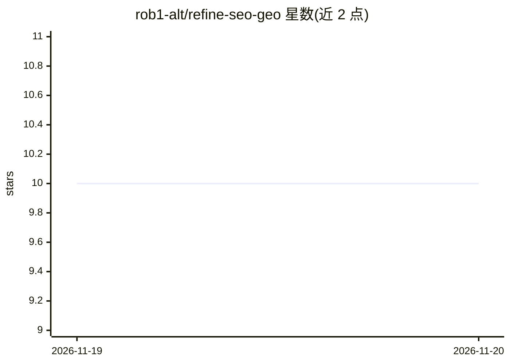

# rob1-alt/refine-seo-geo

⭐ 10 · Python · MIT · 推送 2026-10-02 · [GitHub](https://github.com/rob1-alt/refine-seo-geo) · 个人维护

**给品牌方做的 Claude Code SEO+GEO 优化技能**

一个安装在 Claude Code 或 claude.ai 上的开源（MIT）技能，让用户通过对话对任意品牌站点执行 SEO 与 GEO（生成式引擎优化）工作：输出技术审计分数、AI 可见性报告（提及率与置信区间）、可直接发布的对比页/文章/外联草稿，以及 GA4/GSC/Bing 的度量配置。含六种模式（快速审计、技术审计、可引用内容、站外计划、度量、整体策略）。脚本仅依赖 Python 3.8+ 标准库；收集 AI 回答需外部数据源（tracker 导出、API key 或手动粘贴），技能本身不模拟 AI 回答。

## 筛选速览

| 维度 | 判定 | 备注 |
|---|---|---|
| AI 角色 | `ai-native` | 本体是模型或模型工具 |
| 许可风险 | `permissive` | MIT |
| 部署形态 | `desktop` | 安装包/桌面程序 |
| 模型依赖 | — | README 未给出锁定关系 |
| 硬件要求 | — | 无带数字的原话,不猜 |
| 安装摩擦 | `low` | 无编译、无系统依赖或容器化 |
| 成熟度 | — | 结构信号不足 |

## 能力要点

- 六种模式：审计、技术检查、内容生成、站外引用计划、度量、90 天策略
- 可见性报告以 95% 置信区间统计提及率（scripts/visibility_stats.py），不虚构结果
- 审计覆盖 robots.txt、Cloudflare 机器人控制、JavaScript 渲染内容、sitemap 日期等技术项
- 可配合 Refine MCP 服务器拉取每日追踪数据并发布内容

## 适用场景

- 审计品牌网站在 ChatGPT/Gemini/Perplexity 等回答中的被引用情况
- 生成 'Acme vs Foo' / 'alternatives to X' 类可被 AI 引用的页面
- 检查 AI 爬虫能否抓取站点并修复 robots.txt 阻断
- 建立 GA4/GSC/Bing 度量体系并出具前后对比报告

## 场景标签

`AI 写作` · 领域:内容生成

## 证据(README 行号)

> L1: # Refine — SEO + GEO plugin for Claude
> L11: - **An agent-readiness score** for your site: AI bots blocked in robots.txt or by Cloudflare's 2026 defaults, conte
> L12: - **An AI-visibility report** from real answers (instant with a connected tracker or API keys; otherwise Claude giv

## 星数曲线

2026-11-19 10 → 2026-11-20 10（+0）

---
*卡片 v1 · prompt 1.4 · 生成 2026-11-19 · 置信度 high · 依据 README sha `81896f9ba785` · [字段定义](../../DATASET.md)*
