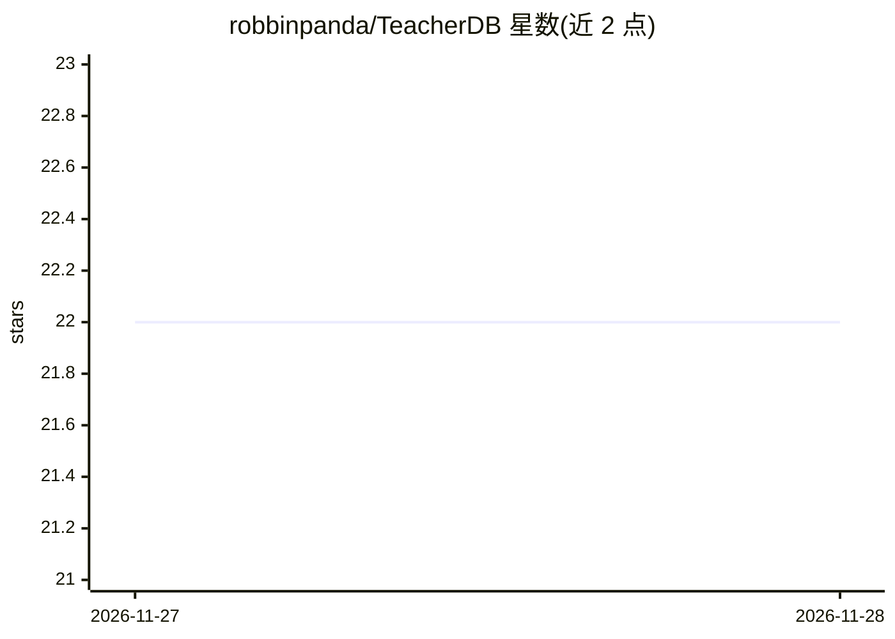

# robbinpanda/TeacherDB

⭐ 22 · TypeScript · 推送 2026-11-26 · [GitHub](https://github.com/robbinpanda/TeacherDB) · [官网](https://teacherdb.cn) · 个人维护 · 中文 README

**给中小学教师的本地优先 AI 题库与智能组卷工具**

本地优先运行的教师题库工作台：批量导入 PDF、Word（含 OMML/MathType 公式）与照片试卷，由视觉模型整卷识别题干、公式、答案解析与知识点，经对照原卷人工审校后存入本机 SQLite 题库。支持全文与组合词检索、可追溯变式题生成（含独立审校评分门槛）、智能组卷模板与 A4 实时预览，导出 Word 原生公式与 PDF 试卷。模型 API Key 经 AES-GCM 加密落盘，数据全部保存在本机；Word 导入需可选 Python 模式，旧版 .doc 需 LibreOffice。

## 筛选速览

| 维度 | 判定 | 备注 |
|---|---|---|
| AI 角色 | `ai-native` | 本体是模型或模型工具 |
| 许可风险 | `none` | — |
| 部署形态 | `library` | 以包/库形式分发 |
| 模型依赖 | locked-api |  |
| 硬件要求 | — | 无带数字的原话,不猜 |
| 安装摩擦 | `low` | 无编译、无系统依赖或容器化 |
| 成熟度 | — | 结构信号不足 |

## 能力要点

- PDF/Word/照片批量导入，AI 整卷上下文识题并提取 LaTeX 公式与知识点
- Word 导出为原生 OMML 可编辑公式（非图片），另可导出 PDF
- 变式生成含命题→规则校验→独立审校评分→人工采用的闭环
- 按月按模型统计 Token 用量与估算费用，支持 RPM 限流与 429 退避

## 适用场景

- 把存量 PDF/Word 试卷批量转成可检索的个人题库
- 按知识点与近期用题情况一键出周测草稿
- 组卷后导出可继续编辑公式的 Word 作业与考试卷
- 基于已复核原题生成并审校变式题

## 场景标签

`文档解析` · 领域:知识与检索

## 证据(README 行号)

> L3: ### 本地优先的 AI 教师题库与智能组卷工作台
> L26: 导入 PDF / Word / 照片  →  AI 整卷识题  →  对照原卷审校  →  沉淀个人题库  →  检索 / 变式 / 出周测  →  导出可编辑 Word / PDF
> L50: |✨ **整卷上下文识题**|全卷一起读题，一次性提取题干、LaTeX 公式、选项、答案、解析、知识点与题图/答案图|

## 星数曲线

2026-11-27 22 → 2026-11-28 22（+0）

---
*卡片 v1 · prompt 1.4 · 生成 2026-11-27 · 置信度 high · 依据 README sha `cc2b57c2d50e` · [字段定义](../../DATASET.md)*
