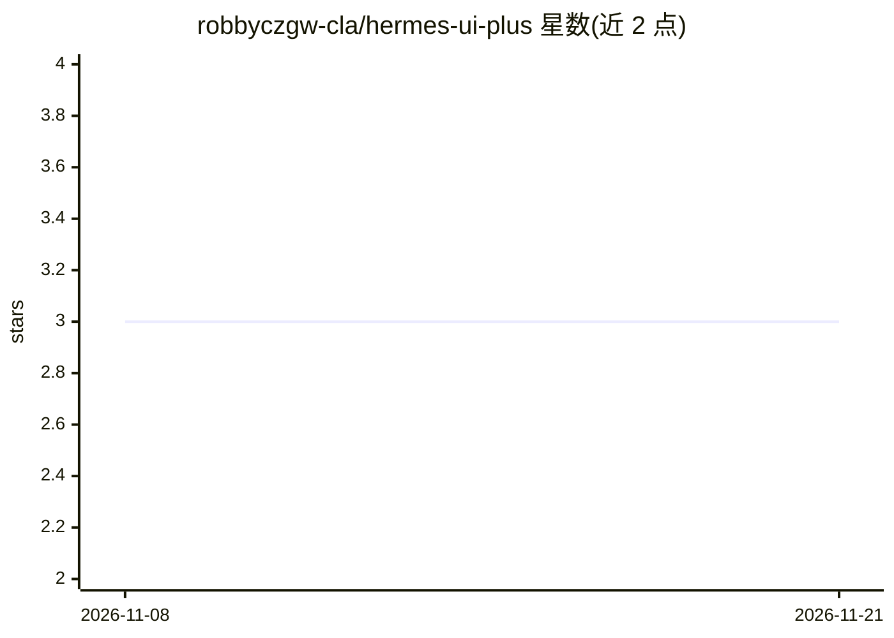

# robbyczgw-cla/hermes-ui-plus

⭐ 3 · TypeScript · MIT · 推送 2026-11-19 · [GitHub](https://github.com/robbyczgw-cla/hermes-ui-plus) · [官网](https://hermesui.xyz) · 个人维护

**自托管 Hermes Agent 的交互式聊天客户端（Android/Web/macOS）**

HUI+ 是面向已自托管 Hermes Agent 用户的非官方开源客户端，覆盖 Android（APK）、Web（PWA）与 macOS/Linux。用户可对 Hermes 返回的 51 种原生答案组件直接操作（勾选清单、选择、填表等），点击结果作为下一条消息回传；支持命令审批卡（允许一次/本任务/始终/拒绝）、实时工具步骤时间线、diff 与终端视图、流式 Markdown 聊天。需配合本机运行的小型 bridge（npx 安装向导），经 Tailscale 或局域网配对；当前为 alpha（0.3）状态。

## 筛选速览

| 维度 | 判定 | 备注 |
|---|---|---|
| AI 角色 | `ai-ecosystem` | LLM/agent 周边工具 |
| 许可风险 | `permissive` | MIT |
| 部署形态 | `desktop` | 安装包/桌面程序 |
| 模型依赖 | — | README 未给出锁定关系 |
| 硬件要求 | — | 无带数字的原话,不猜 |
| 安装摩擦 | `low` | 无编译、无系统依赖或容器化 |
| 成熟度 | `idea` | |

## 能力要点

- 51 种原生答案组件，其中 25 种可交互，点击结果回传为下一条消息
- 命令审批卡：展示命令、理由与预估风险，支持多种允许级别
- 本地 bridge 搭配一次性配对码与可撤销设备令牌，无托管服务无账户
- 共享、草稿、回复引用与阅读位置等聊天基础功能

## 适用场景

- 在手机上查看并交互 Hermes Agent 的回答与工具执行过程
- 远程审批或拒绝 Hermes 要执行的 shell 命令
- 通过 Tailscale 在私有网络内安全连接自托管 agent

## 场景标签

`聊天机器人` · 领域:对话与助手

## 证据(README 行号)

> L7: **HUI+** (Hermes Interactive UI+; HUI+ is the name under the app icon) is a mobile, web and desktop app for your own
> L11: - **Who it is for:** people who already run Hermes Agent and talk to it through Telegram or the terminal today.
> L12: - **What you need:** your own Hermes Agent (v0.21 or newer) and a **small bridge** that you run next to it (`npx he

## 星数曲线

2026-11-08 3 → 2026-11-21 3（+0）

---
*卡片 v1 · prompt 1.4 · 生成 2026-11-21 · 置信度 high · 依据 README sha `bb78cafd9dcf` · [字段定义](../../DATASET.md)*
