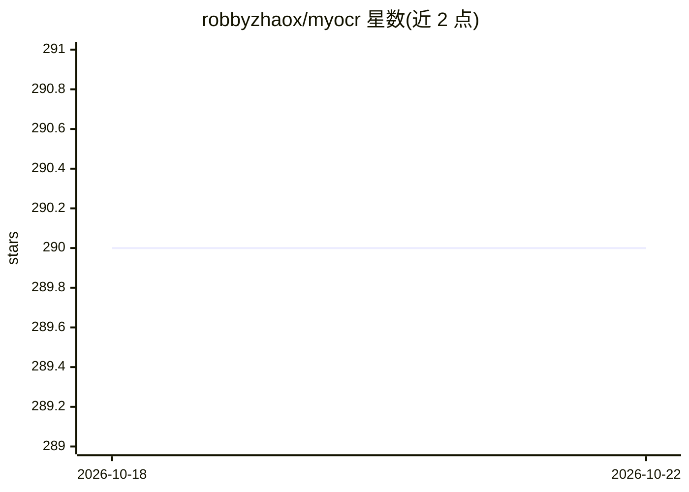

# robbyzhaox/myocr

⭐ 290 · Python · Apache-2.0 · 推送 2025-10-27 · [GitHub](https://github.com/robbyzhaox/myocr) · [官网](https://robbyzhaox.github.io/myocr/) · 个人维护 · 中文 README

**构建 OCR 系统的可扩展 Python 框架**

面向工程师的端到端 OCR 开发框架，支持在统一管线中集成检测、识别及自定义模型，可替换模型、预测器与输入输出处理器。推理基于 ONNX runtime，支持 CPU/GPU；提供常见 OCR 管线、结构化输出管线（如发票信息抽取，配置 Ollama 或 OpenAI API 的 chat bot）、Docker 部署与 Flask REST API。要求 Python 3.11+，GPU 加速建议 CUDA 12.6 以上，也支持纯 CPU 模式。

## 筛选速览

| 维度 | 判定 | 备注 |
|---|---|---|
| AI 角色 | `ai-native` | 本体是模型或模型工具 |
| 许可风险 | `permissive` | Apache-2.0 |
| 部署形态 | `self-host` | docker 或自建部署 |
| 模型依赖 | local-ok | 支持本地模型 |
| 硬件要求 | `cpu-ok` | |
| 安装摩擦 | `low` | 无编译、无系统依赖或容器化 |
| 成熟度 | — | 结构信号不足 |

## 能力要点

- 统一管线中构建/替换检测、识别与自定义 OCR 模型的模块化框架
- 结构化 OCR 输出管线（如发票信息抽取），chat bot 支持 Ollama/OpenAI API
- ONNX runtime 支持 CPU/GPU 推理
- 提供 Docker 部署与 Flask REST API（/ping、/ocr、/ocr-json）

## 适用场景

- 我需要把检测、识别模型组装成自定义 OCR 管线
- 我想从发票等图片抽取结构化字段
- 我想通过 Docker 或 REST API 提供 OCR 服务

## 场景标签

`OCR` `文档解析` · 领域:知识与检索

## 证据(README 行号)

> L12: MyOCR is a highly extensible and customizable framework for building OCR systems. Engineers can easily train, integ
> L19: **⚡️ End-to-End OCR Development Framework** – Designed for developers to build and integrate detection, recognition

## 星数曲线

2026-10-18 290 → 2026-10-22 290（+0）

---
*卡片 v1 · prompt 1.4 · 生成 2026-10-22 · 置信度 mid · 依据 README sha `a68e618a35ac` · [字段定义](../../DATASET.md)*
