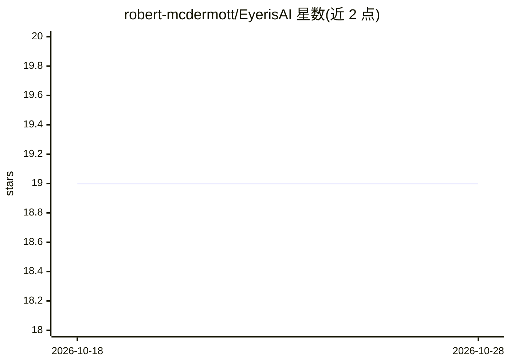

# robert-mcdermott/EyerisAI

⭐ 19 · Python · Apache-2.0 · 推送 2025-11-23 · [GitHub](https://github.com/robert-mcdermott/EyerisAI) · 个人维护

**AI 摄像头事件检测系统：视觉监控并语音/邮件响应**

基于计算机、网络摄像头、OpenCV 运动检测与多模态 LLM 的实时事件监控系统：用户通过配置 prompt 告知 AI 关注什么及如何反应，触发后由生成式 AI 分析画面，记录日志并以 TTS 朗读或发送邮件告警。支持任意 OpenAI 兼容 API（含 LiteLLM Proxy），可完全本地运行（Ollama + Moondream2），也可接入 Azure OpenAI 或 AWS Bedrock 上的 Anthropic 模型。以 Python 脚本形式提供，通过编辑 config.ini 配置摄像头、灵敏度与模型。

## 筛选速览

| 维度 | 判定 | 备注 |
|---|---|---|
| AI 角色 | `ai-native` | 本体是模型或模型工具 |
| 许可风险 | `permissive` | Apache-2.0 |
| 部署形态 | `library` | 以包/库形式分发 |
| 模型依赖 | local-ok | 支持本地模型 |
| 硬件要求 | — | 无带数字的原话,不猜 |
| 安装摩擦 | `low` | 无编译、无系统依赖或容器化 |
| 成熟度 | `idea` | |

## 能力要点

- prompt 定义监控目标与响应方式的摄像头事件检测
- 触发后 LLM 分析场景，TTS 朗读或邮件告警
- 完全本地运行可行（Ollama + Moondream2，约 4.5GB）
- 兼容任意 OpenAI 兼容 API，可经 LiteLLM 接入 OpenAI/Anthropic

## 适用场景

- 医疗机构或家庭中的跌倒检测与告警
- 离家时的家庭安防监控与入侵提醒
- 婴儿、宠物或老人行为看护
- 工地安全与设备状态观察记录

## 场景标签

`多模态` `语音合成` · 领域:内容生成

## 证据(README 行号)

> L8: EyerisAI (pronounced “IrisAI”, 👁️ + 🤖) is a project to create an AI-powered camera and event detection system that u
> L72: - Ollama 0.5.11

## 星数曲线

2026-10-18 19 → 2026-10-28 19（+0）

---
*卡片 v1 · prompt 1.4 · 生成 2026-10-28 · 置信度 high · 依据 README sha `e01c59d9c438` · [字段定义](../../DATASET.md)*
