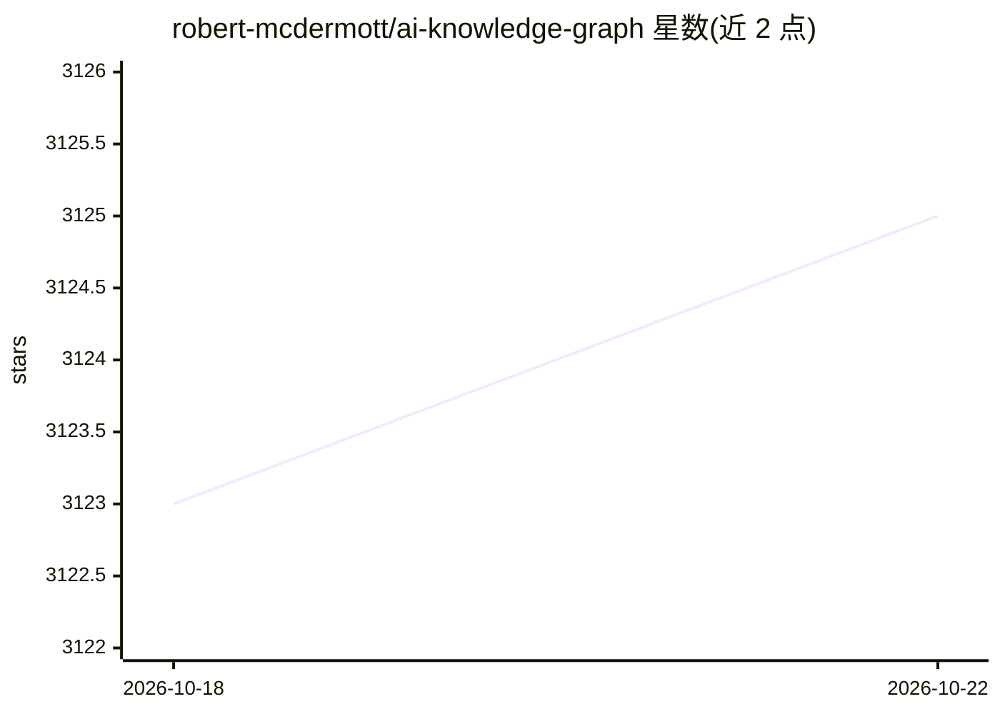

# robert-mcdermott/ai-knowledge-graph

⭐ 3,125 · Python · Apache-2.0 · 推送 2026-09-13 · [GitHub](https://github.com/robert-mcdermott/ai-knowledge-graph) · [官网](https://robert-mcdermott.medium.com/from-unstructured-text-to-interactive-knowledge-graphs-using-llms-dd02a1f71cd6) · 个人维护

**用任意 LLM 从非结构化文本生成知识图谱并交互探索**

读取 .txt/.md/.rst/.pdf/.docx 文档，调用任意 OpenAI 兼容端点的 LLM 抽取带实体类型的主谓宾三元组，做实体归并与可溯源的保守推理，输出自包含交互式 HTML 图谱及 JSON/CSV/GraphML/Neo4j Cypher 导出。附带 graph-chat（基于图谱事实的引用式问答）与 graph-serve（本地 Web 界面，含摄取与浏览）。规则型推理默认关闭，因其曾产生约 70% 的边并掩盖文中实际关系。

## 筛选速览

| 维度 | 判定 | 备注 |
|---|---|---|
| AI 角色 | `ai-native` | 本体是模型或模型工具 |
| 许可风险 | `permissive` | Apache-2.0 |
| 部署形态 | `library` | 以包/库形式分发 |
| 模型依赖 | local-ok | 支持本地模型 |
| 硬件要求 | — | 无带数字的原话,不猜 |
| 安装摩擦 | `low` | 无编译、无系统依赖或容器化 |
| 成熟度 | — | 结构信号不足 |

## 能力要点

- LLM 抽取带实体类型与来源句的三元组，长文档按句子边界切分并行处理
- 导出 JSON/CSV/GraphML（Gephi/yEd/Cytoscape）与 Neo4j Cypher 脚本
- graph-chat 从图谱子图回答问题并标注 extracted/inferred 依据
- 兼容任意 OpenAI 兼容端点，含本地 Ollama；带响应缓存与重试

## 适用场景

- 把历史、传记、流程类文档变成可探索的知识图谱
- 对已生成图谱做带引用来源的问答
- 导出到 Gephi/Cytoscape/Neo4j 做进一步图分析

## 场景标签

`知识图谱` `文档问答` · 领域:知识与检索

## 证据(README 行号)

> L5: This system takes an unstructured text document, and uses an LLM of your choice to extract knowledge in the form of 
> L26: - **Works with any OpenAI-compatible endpoint**: Ollama, LM Studio, vLLM, OpenAI, Gemini, OpenRouter, LiteLLM (whic

## 星数曲线

2026-10-18 3,123 → 2026-10-22 3,125（+2）

---
*卡片 v1 · prompt 1.4 · 生成 2026-10-20 · 置信度 high · 依据 README sha `2e78f2e3b8a6` · [字段定义](../../DATASET.md)*
