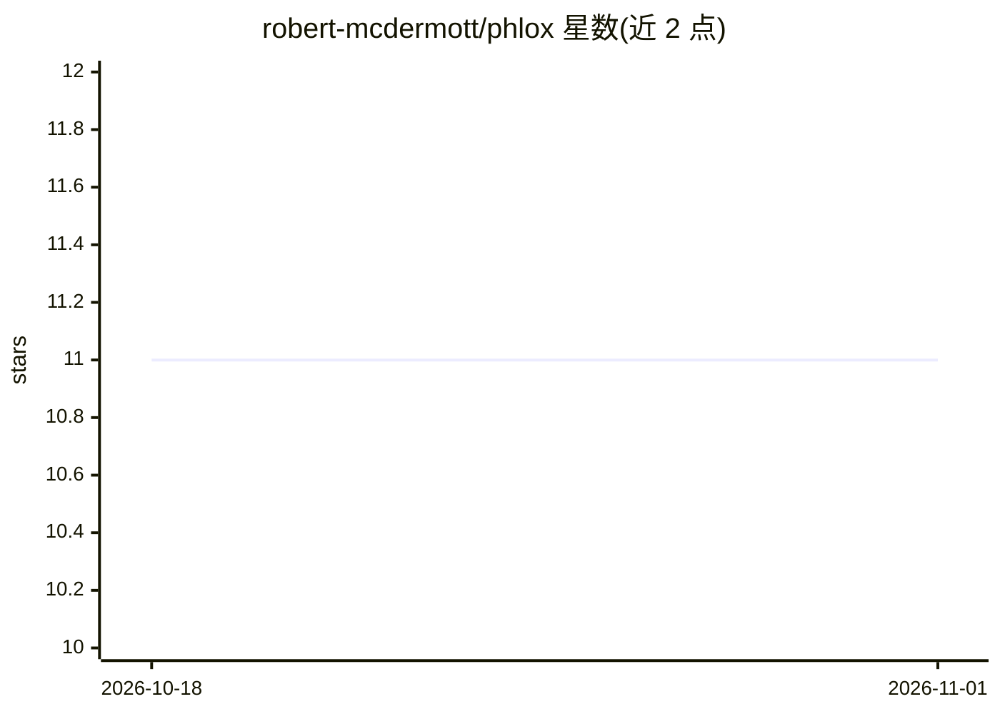

# robert-mcdermott/phlox

⭐ 11 · Python · Apache-2.0 · 推送 2026-09-21 · [GitHub](https://github.com/robert-mcdermott/phlox) · [官网](https://robert-mcdermott.github.io/phlox/) · 个人维护

**可自托管的 ChatGPT 风格 AI 助手平台**

自托管的多用户 AI 对话与工作平台：支持接入 AWS Bedrock 或任意 OpenAI 兼容端点（含 Ollama、LM Studio、vLLM 等本地推理）。功能包括带权限控制与人工审批的 Agent 工作流、Python/JavaScript 代码执行（本地或 Docker/Podman 隔离）、带引用溯源的文档与网页检索、公共卫生数据（NIH RePORTER/PubMed/ClinicalTrials.gov）报告生成、MCP 工具接入与 OpenAI 兼容 API 网关、跨对话记忆、用量预算管理。本地安装需 Git、uv、Python 3.11+ 与 Node/npm，通过脚本启动，不自带模型服务器。

## 筛选速览

| 维度 | 判定 | 备注 |
|---|---|---|
| AI 角色 | `ai-native` | 本体是模型或模型工具 |
| 许可风险 | `permissive` | Apache-2.0 |
| 部署形态 | `None` |  |
| 模型依赖 | local-ok | 支持本地模型 |
| 硬件要求 | — | 无带数字的原话,不猜 |
| 安装摩擦 | `low` | 无编译、无系统依赖或容器化 |
| 成熟度 | — | 结构信号不足 |

## 能力要点

- 连接 AWS Bedrock 或任意 OpenAI 兼容端点（Ollama/LM Studio/vLLM），无需云端 API key 即可用本地推理
- Agent 工作流：规划、子代理、文件系统与 shell 工具，带逐工具权限与人工审批
- 带引用溯源的文档与网页研究模式，可检视引用背后的保留段落
- MCP 集成与 OpenAI 兼容 API 网关（按用户 API key）

## 适用场景

- 自建带权限控制和审批机制的 AI 助手与文档研究环境
- 用本地模型在自有机器上完成对话、嵌入与代码执行
- 团队共享使用：多用户账户、预算跟踪与用量管理

## 场景标签

`AI 助手` `文档问答` · 领域:对话与助手

## 证据(README 行号)

> L3:  A feature-rich, ChatGPT-style, self-hostable AI assistant.
> L10: Phlox is a self-hosted AI assistant for conversation, document research, and tool-assisted
> L12: such as Ollama, LM Studio, and vLLM. Model capabilities depend on the selected provider.

## 星数曲线

2026-10-18 11 → 2026-11-01 11（+0）

---
*卡片 v1 · prompt 1.4 · 生成 2026-11-01 · 置信度 high · 依据 README sha `93d4f73910d4` · [字段定义](../../DATASET.md)*
