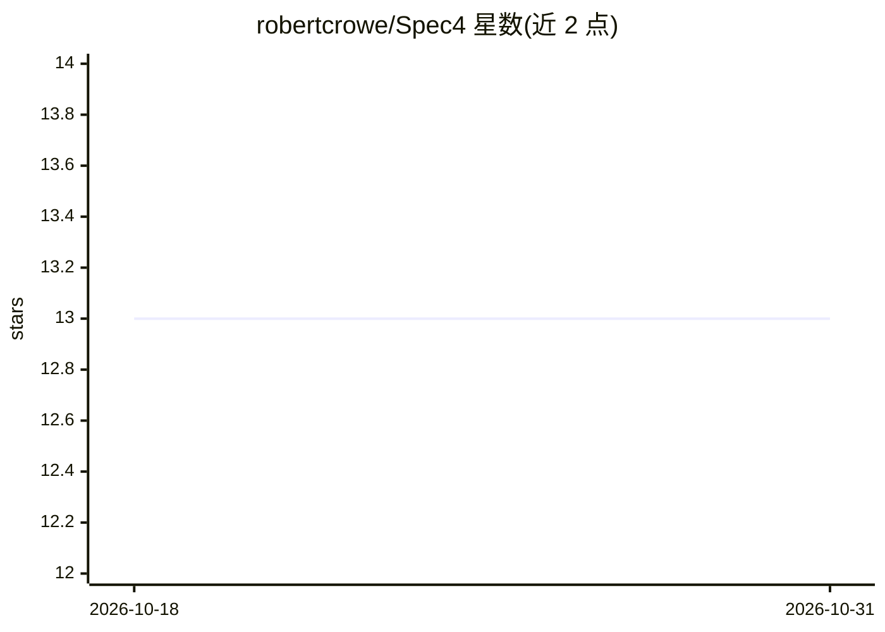

# robertcrowe/Spec4

⭐ 13 · Python · NOASSERTION · 推送 2026-10-26 · [GitHub](https://github.com/robertcrowe/Spec4) · [官网](https://spec4.ai) · 个人维护

**本地规划工具：把想法或既有代码变成给编码 agent 的有序开发阶段**

面向开发者的 spec 驱动开发规划工具：七个规划 agent（CodeScanner、Brainstormer、Agentifier、Designer、StackAdvisor、Phaser、Deployer）按序运行，读取代码与愿景，产出写入项目 .spec4/ 目录的文件——代码审查、特性规格、技术栈、有序实施阶段（每个阶段含风险与验证命令）、HTML UI mock 与部署计划。规划以轮次进行，每轮从代码现状重新出发。本身不写代码，产出交给用户选用的编码 agent；本地运行，API key 存于浏览器。需要 Python 3.12+、uv 与至少一个模型供应商的 API key。

## 筛选速览

| 维度 | 判定 | 备注 |
|---|---|---|
| AI 角色 | `ai-ecosystem` | LLM/agent 周边工具 |
| 许可风险 | `none` | NOASSERTION |
| 部署形态 | `self-host` | docker 或自建部署 |
| 模型依赖 | locked-api |  |
| 硬件要求 | — | 无带数字的原话,不猜 |
| 安装摩擦 | `low` | 无编译、无系统依赖或容器化 |
| 成熟度 | — | 结构信号不足 |

## 能力要点

- 七个规划 agent 流水线，产出全为 .spec4/ 下的项目内文件
- 以轮次（round）组织规划：每轮从代码实际状态重扫并度量漂移
- 每个阶段含 JSON frontmatter、风险评估与可执行的 Verification 命令
- Agentifier 按 9 级复杂度阶梯为 AI 特性分档并起草规格

## 适用场景

- 把粗略想法转成编码 agent 可直接执行的有序阶段计划
- 对既有代码库做修订轮规划，只规划变更部分
- 为生产系统生成含失败模式与部署配置的完整规格

## 场景标签

 · 领域:软件开发/AI 规划工具

## 证据(README 行号)

> L7: Spec4 turns an idea into a set of structured, ordered development phases — plus an optional UI mock and a deployment
> L9: It is not a coding agent. It doesn't write your application; it writes the plan your coding agent builds from — with

## 星数曲线

2026-10-18 13 → 2026-10-31 13（+0）

---
*卡片 v1 · prompt 1.4 · 生成 2026-10-31 · 置信度 mid · 依据 README sha `66e82e6548f9` · [字段定义](../../DATASET.md)*
