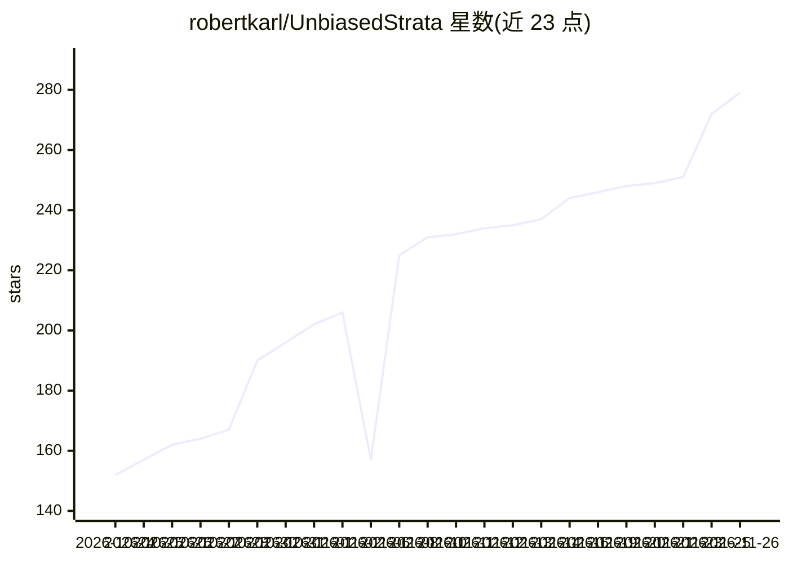

# robertkarl/UnbiasedStrata

⭐ 279 · C++ · MIT · 推送 2026-11-22 · [GitHub](https://github.com/robertkarl/UnbiasedStrata) · 个人维护

**去安装器化的 Strata 分支：源码编译后本地服务 OpenAI 风格聊天 API**

PolyStrata v0.1.45-poly.1 的分支，保留其两个推理引擎不变，替换周边全部组件：去除安装器与构建/启动时下载，前端由 llama.cpp 服务器代码构建为 C++ 程序 unbiased-strata，提供 /v1/chat/completions 等端点。面向拥有 NVIDIA GPU（Pascal 或更新、CUDA 12.x）Linux x86-64 机器的用户，可在完全离线环境运行。支持 Qwen3.8-Flash-Next、Qwen3.6-35B-A3B、DeepSeek-V4.1 等模型与图像输入，附带与上游的基准对比记录。

## 筛选速览

| 维度 | 判定 | 备注 |
|---|---|---|
| AI 角色 | `ai-ecosystem` | LLM/agent 周边工具 |
| 许可风险 | `permissive` | MIT |
| 部署形态 | `library` | 以包/库形式分发 |
| 模型依赖 | local-ok | 支持本地模型 |
| 硬件要求 | — | 无带数字的原话,不猜 |
| 安装摩擦 | `high` | 编译与系统依赖俱全 |
| 成熟度 | — | 结构信号不足 |

## 能力要点

- 单条 make build 在 Linux+NVIDIA 机器上产出引擎与 C++ 前端
- 从 llama.cpp 服务器代码提供 OpenAI 风格聊天 API，请求与 token 之间无 Python
- 支持图像输入（mtmd 编码）与推理输出 reasoning_content、函数调用
- 保留与上游 PolyStrata 在同一硬件上的逐项基准对比数据

## 适用场景

- 在离线内网机器上本地部署聊天推理服务
- 以更少构建期步骤克隆并编译 Strata 类推理栈
- 在 Pascal 老卡（GTX 1080 Ti）上运行量化 GGUF 模型

## 场景标签

`推理引擎` · 领域:训练与推理

## 证据(README 行号)

> L36: unchanged and replaces everything around them: no installer, no downloads at build or start, no Python between a
> L38: `unbiased-strata`, that serves an OpenAI-style chat API from llama.cpp's own server code. The target is one NVIDIA 
> L90: modes: docs/MEMORY_LAYOUT.md. The server answers `/v1/chat/completions` (streaming and not), `/v1/models`,

## 星数曲线

2026-10-24 152 → 2026-11-26 279（+127）

---
*卡片 v1 · prompt 1.4 · 生成 2026-11-25 · 置信度 mid · 依据 README sha `d51ba1835cd1` · [字段定义](../../DATASET.md)*
