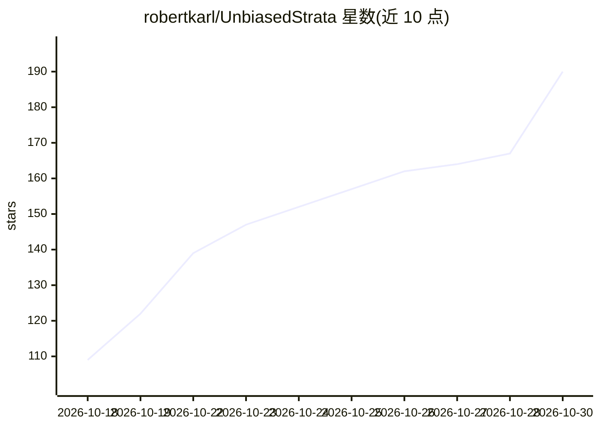

# robertkarl/UnbiasedStrata

⭐ 190 · C++ · MIT · 推送 2026-10-24 · [GitHub](https://github.com/robertkarl/UnbiasedStrata) · 个人维护

**离线 NVIDIA 单卡部署的 Strata 推理引擎 C++ 前端**

PolyStrata v0.1.45-poly.1 的 fork，保留其两个推理引擎，移除安装器、构建/启动时下载与请求路径上的 Python，替换为 C++ 前端 unbiased-strata：基于 llama.cpp server 代码提供 OpenAI 风格 chat API（/v1/chat/completions 流式与非流式等），一次 make build 生成引擎与前端。目标环境为 Linux x86-64、单张 NVIDIA GPU（Pascal 及以上）、CUDA 12.x，可完全离线运行；模型 GGUF 文件需自行在有网机器下载拷贝。支持图片输入（mmproj 投影器）与 MTP 投解码，附有 tokens/s 基准与对 llama.cpp 的正确性核验记录。

## 筛选速览

| 维度 | 判定 | 备注 |
|---|---|---|
| AI 角色 | `ai-ecosystem` | LLM/agent 周边工具 |
| 许可风险 | `permissive` | MIT |
| 部署形态 | `None` |  |
| 模型依赖 | local-ok | 支持本地模型 |
| 硬件要求 | — | 无带数字的原话,不猜 |
| 安装摩擦 | `medium` | 含编译或系统依赖之一 |
| 成熟度 | `idea` | |

## 能力要点

- 一次 make build 产出引擎与 C++ 前端，无安装器、无运行时下载、无 Python 中间层
- 提供 OpenAI 风格 API（chat completions 流式/非流式、models、tokenize 等）
- 目标单张 NVIDIA GPU（Pascal+）、CUDA 12.x、Linux x86-64，可在无网络机器运行
- 支持 GGUF 模型、mmproj 图片输入与 MTP 投解码 pack 离线制作

## 适用场景

- 在离线 Linux + NVIDIA 单卡机器上自托管 Qwen 类 GGUF 模型服务
- 用 OpenAI 兼容 API 从本地 Strata/PolyStrata 引擎获取推理输出
- 对比上游 PolyStrata 与本 fork 的吞吐与正确性

## 场景标签

`推理引擎` · 领域:训练与推理

## 证据(README 行号)

> L35: A fork of PolyStrata v0.1.45-poly.1 that keeps its two inference engines
> L38: `unbiased-strata`, that serves an OpenAI-style chat API from llama.cpp's own server code. The target is one NVIDIA 

## 星数曲线

2026-10-18 109 → 2026-10-30 190（+81）

---
*卡片 v1 · prompt 1.4 · 生成 2026-10-22 · 置信度 high · 依据 README sha `26a6441ab8e9` · [字段定义](../../DATASET.md)*
