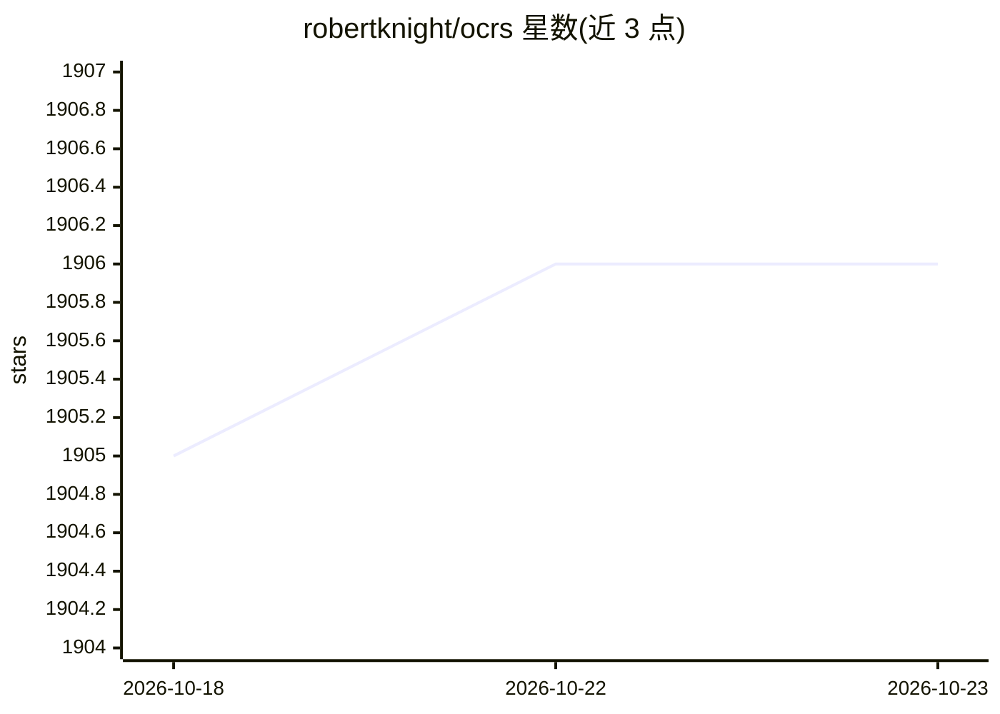

# robertknight/ocrs

⭐ 1,906 · Rust · Apache-2.0 · 推送 2026-10-22 · [GitHub](https://github.com/robertknight/ocrs) · 个人维护

**Rust 编写的 OCR 库与 CLI：从图像中提取文本**

Rust 语言实现的 OCR 库及命令行工具，用于从扫描文档、照片、截图等图像中提取文本，目标是减少传统引擎所需的预处理工作。管线内使用 PyTorch 训练、导出为 ONNX 并由 RTen 引擎执行的神经网络模型，首次运行时自动下载模型至 ~/.cache/ocrs。当前为早期预览版，仅支持拉丁字母，更多语言支持在计划中。CLI 通过 cargo install 安装，支持输出纯文本、JSON 布局信息与标注图像，另提供 Rust 库形式使用方式。

## 筛选速览

| 维度 | 判定 | 备注 |
|---|---|---|
| AI 角色 | `ai-native` | 本体是模型或模型工具 |
| 许可风险 | `permissive` | Apache-2.0 |
| 部署形态 | `library` | 以包/库形式分发 |
| 模型依赖 | — | README 未给出锁定关系 |
| 硬件要求 | — | 无带数字的原话,不猜 |
| 安装摩擦 | `low` | 无编译、无系统依赖或容器化 |
| 成熟度 | `idea` | |

## 能力要点

- 基于神经网络模型（PyTorch 训练、ONNX 导出、RTen 执行）的 OCR 管线
- CLI 支持文本、JSON 布局与标注图像三种输出
- 首次运行自动下载模型，无需手动配置
- 支持 WebAssembly 编译目标

## 适用场景

- 从扫描文档或截图中提取文本
- 在 Rust 项目中以库形式集成 OCR 能力
- 获取图像中文字的位置与布局信息

## 场景标签

`OCR` · 领域:感知与多模态

## 证据(README 行号)

> L3: **ocrs** is a Rust library and CLI tool for extracting text from images, also known as OCR (Optical Character Recogn
> L16: Under the hood, the library uses neural network models trained in
> L17: [PyTorch][pytorch], which are then exported to [ONNX][onnx] and executed using

## 星数曲线

2026-10-18 1,905 → 2026-10-23 1,906（+1）

---
*卡片 v1 · prompt 1.4 · 生成 2026-10-21 · 置信度 high · 依据 README sha `cb9cefbc7732` · [字段定义](../../DATASET.md)*
