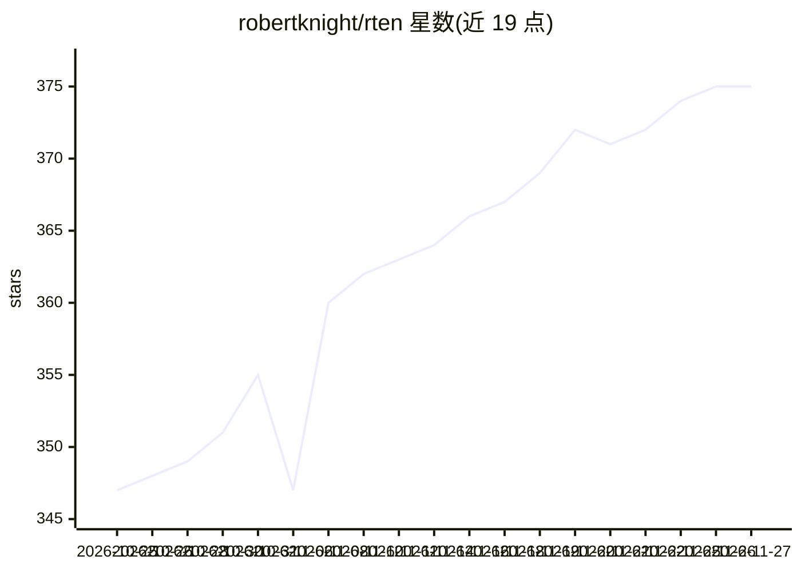

# robertknight/rten

⭐ 375 · Rust · Apache-2.0 · 推送 2026-11-26 · [GitHub](https://github.com/robertknight/rten) · 个人维护

**供 Rust 应用运行 ONNX 模型的推理引擎**

RTen（Rust Tensor engine）是一个用 Rust 编写的机器学习运行时，读取 ONNX 格式模型，使 Python 中由 PyTorch 等框架训练的模型可在 Rust 应用中运行推理。目标包括支持 WebAssembly 等多种平台、全 Rust 依赖以简化构建部署。当前仅支持 CPU 推理，通过 AVX2/AVX-512/Arm Neon/WASM SIMD 提供 SIMD 加速，支持 f32 与 int8 量化权重，f16 权重加载时转为 f32。另提供 CLI 工具与前后处理库。

## 筛选速览

| 维度 | 判定 | 备注 |
|---|---|---|
| AI 角色 | `ai-ecosystem` | LLM/agent 周边工具 |
| 许可风险 | `permissive` | Apache-2.0 |
| 部署形态 | `library` | 以包/库形式分发 |
| 模型依赖 | — | README 未给出锁定关系 |
| 硬件要求 | — | 无带数字的原话,不猜 |
| 安装摩擦 | `low` | 无编译、无系统依赖或容器化 |
| 成熟度 | — | 结构信号不足 |

## 能力要点

- 纯 Rust 实现，无 Python 依赖，简化构建与部署
- 支持 ONNX 标准算子及部分 contrib ops，f32 与 int8 权重
- CPU 推理支持 AVX2/AVX-512/Arm Neon/WebAssembly SIMD，默认多线程
- 提供 WebAssembly API 供 JavaScript 应用调用，附 rten-cli 模型检查工具

## 适用场景

- 把 PyTorch 训练并导出为 ONNX 的模型部署到 Rust 应用
- 在浏览器中通过 WebAssembly 运行图像分类等模型
- 用 CLI 快速测试某个 ONNX 模型是否兼容并测量性能

## 场景标签

`推理引擎` · 领域:训练与推理

## 证据(README 行号)

> L4: RTen (the _Rust Tensor engine_) † is a machine learning runtime. It supports
> L5: models in ONNX format. RTen enables you to take machine
> L7: PyTorch and run them in Rust.

## 星数曲线

2026-10-25 347 → 2026-11-27 375（+28）

---
*卡片 v1 · prompt 1.4 · 生成 2026-11-25 · 置信度 high · 依据 README sha `24e06621e0e8` · [字段定义](../../DATASET.md)*
