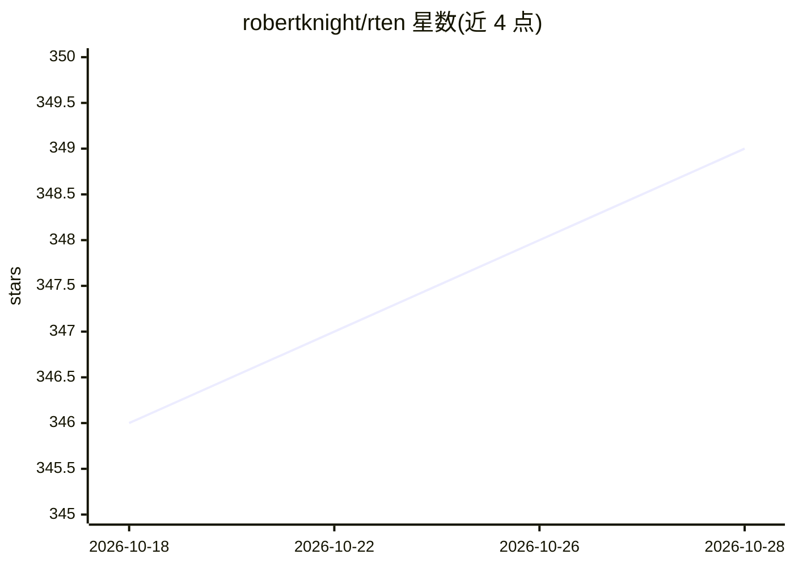

# robertknight/rten

⭐ 349 · Rust · Apache-2.0 · 推送 2026-10-28 · [GitHub](https://github.com/robertknight/rten) · 个人维护

**Rust 编写的 ONNX 模型 CPU 推理运行时**

RTen 是用 Rust 实现的机器学习运行时，读取 ONNX 格式模型并在 Rust 应用中执行推理，支持 PyTorch 等框架导出的模型。仅支持 CPU 推理，通过 AVX2、AVX-512、Arm Neon 与 WebAssembly SIMD 加速，默认按物理核数多线程。支持大多数标准 ONNX 算子及部分 ONNX Runtime contrib 算子，支持 f32 与 int8 量化权重（f16 加载时上转为 f32）。附带前后处理库与 JavaScript/WebAssembly 使用路径，可通过 crates.io 或源码构建。

## 筛选速览

| 维度 | 判定 | 备注 |
|---|---|---|
| AI 角色 | `ai-ecosystem` | LLM/agent 周边工具 |
| 许可风险 | `permissive` | Apache-2.0 |
| 部署形态 | `library` | 以包/库形式分发 |
| 模型依赖 | — | README 未给出锁定关系 |
| 硬件要求 | — | 无带数字的原话,不猜 |
| 安装摩擦 | `low` | 无编译、无系统依赖或容器化 |
| 成熟度 | — | 结构信号不足 |

## 能力要点

- 端到端 Rust 实现，依赖均为 Rust 编写
- 支持 ONNX 标准算子与 ONNX Runtime contrib 算子
- CPU 推理，SIMD（AVX2/AVX-512/Neon/WASM SIMD）加速，默认多线程
- 提供 WebAssembly 构建与 JavaScript API 运行模型

## 适用场景

- 将 PyTorch 等框架训练的模型部署到 Rust 应用中
- 在浏览器中通过 WebAssembly 运行 ONNX 模型
- 在 CPU 环境下执行图像分类等推理任务

## 场景标签

`推理引擎` · 领域:训练与推理

## 证据(README 行号)

> L4: RTen (the _Rust Tensor engine_) † is a machine learning runtime. It supports
> L5: models in ONNX format. RTen enables you to take machine

## 星数曲线

2026-10-18 346 → 2026-10-28 349（+3）

---
*卡片 v1 · prompt 1.4 · 生成 2026-10-21 · 置信度 high · 依据 README sha `fa11fed74e7d` · [字段定义](../../DATASET.md)*
