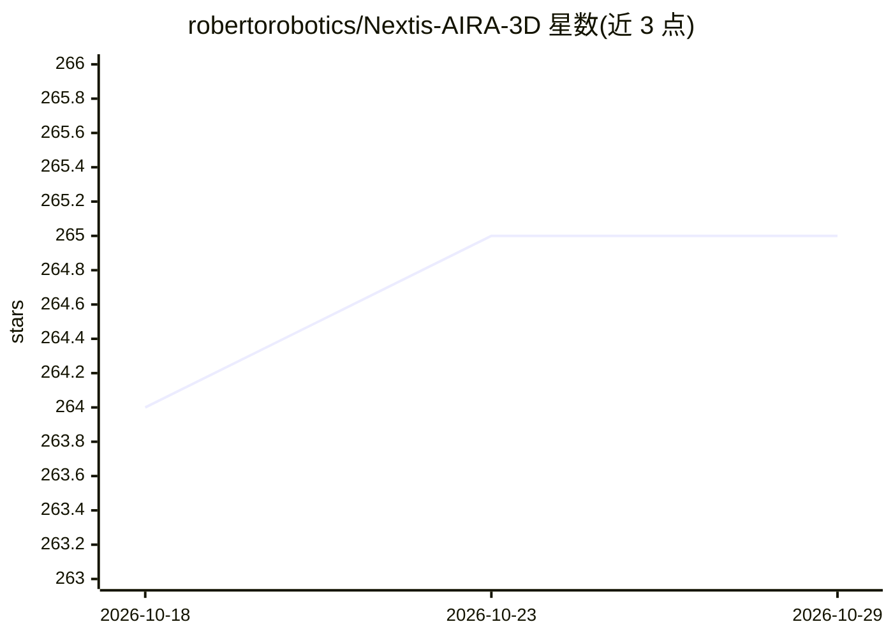

# robertorobotics/Nextis-AIRA-3D

⭐ 265 · Python · Apache-2.0 · 推送 2026-03-12 · [GitHub](https://github.com/robertorobotics/Nextis-AIRA-3D) · [官网](https://www.nextis.tech/hardware) · 组织维护

**3D 打印 7 自由度机械臂，原生接入 LeRobot 做模仿学习**

Nextis 开发的可 3D 打印 7 自由度（6+夹爪）机械臂，作为 LeRobot 插件（非 fork）接入 Hugging Face 机器人框架：支持主从臂遥操作、演示数据录制，并用 ACT、Diffusion Policy、PI0、GR00T N1.5 等策略训练与部署。自研 Damiao CAN 总线电机驱动补足 LeRobot 缺失的 CAN 支持，提供 aira-setup 交互式电机配置向导。整套硬件估算成本 €2,000–€2,500，也可购买成品套件。声明处于 Early Access，高扭矩电机需注意安全。

## 筛选速览

| 维度 | 判定 | 备注 |
|---|---|---|
| AI 角色 | `ai-ecosystem` | LLM/agent 周边工具 |
| 许可风险 | `permissive` | Apache-2.0 |
| 部署形态 | `library` | 以包/库形式分发 |
| 模型依赖 | — | README 未给出锁定关系 |
| 硬件要求 | — | 无带数字的原话,不猜 |
| 安装摩擦 | `low` | 无编译、无系统依赖或容器化 |
| 成熟度 | `idea` | |

## 能力要点

- LeRobot 插件架构，开箱支持 ACT/Diffusion Policy/PI0/GR00T N1.5
- 自研 Damiao CAN 总线电机驱动，补足 LeRobot 的 CAN 空缺
- aira-setup 逐电机配置向导与 MIT 阻抗控制
- 全套硬件估算 €2,000–€2,500，可自行打印或购买套件

## 适用场景

- 搭建低成本机械臂并录制演示数据
- 用 LeRobot 训练和部署模仿学习策略
- 通过主从臂遥操作执行抓取等任务

## 场景标签

 · 领域:机器人/具身智能

## 证据(README 行号)

> L33: AIRA is a 3D-printable, 7-DoF (6-DoF + 1-DoF Gripper) robotic arm with native integration into LeRobot — Hugging Fa
> L66: - **LeRobot Native** — plugin architecture, not a fork. ACT, Diffusion Policy, PI0, GR00T N1.5 out of the box

## 星数曲线

2026-10-18 264 → 2026-10-29 265（+1）

---
*卡片 v1 · prompt 1.4 · 生成 2026-10-22 · 置信度 high · 依据 README sha `abf75b7a2907` · [字段定义](../../DATASET.md)*
