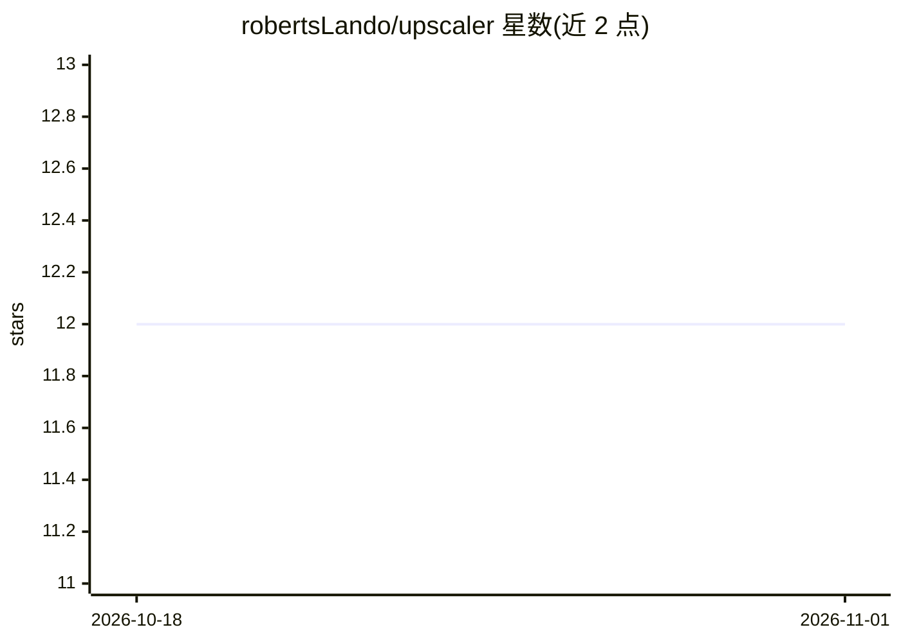

# robertsLando/upscaler

⭐ 12 · Python · 推送 2026-02-16 · [GitHub](https://github.com/robertsLando/upscaler) · 个人维护

**基于 Real-ESRGAN 的图像放大工具，提供 Web API 与 UI**

使用 RealESRGAN_x4plus 模型将图像放大 4 倍，再按目标尺寸等比缩放，输出 PNG。面向需要批量或程序化放大图片的开发者与普通用户：提供 FastAPI Web 服务与浏览器 UI、RESTful API（POST /upscale，支持像素或厘米+DPI 两种尺寸模式）、以及支持 glob 模式批量处理的 CLI。模型约 64MB，首次使用自动下载，默认 CPU 运行（GPU 需改代码启用）。安装途径为 Docker（docker-compose 或拉取 ghcr 镜像）或 uv 本地源码安装，需 Python 3.12+。

## 筛选速览

| 维度 | 判定 | 备注 |
|---|---|---|
| AI 角色 | `ai-native` | 本体是模型或模型工具 |
| 许可风险 | `permissive` | — |
| 部署形态 | `self-host` | docker 或自建部署 |
| 模型依赖 | — | README 未给出锁定关系 |
| 硬件要求 | `cpu-ok` | |
| 安装摩擦 | `low` | 无编译、无系统依赖或容器化 |
| 成熟度 | — | 结构信号不足 |

## 能力要点

- Real-ESRGAN x4plus 模型 4x 放大，等比保持宽高比
- CLI 支持 glob 模式批量处理
- 像素与厘米+DPI 双尺寸输入模式
- FastAPI Web UI 与 REST API（POST /upscale、/health）

## 适用场景

- 批量放大照片或 artwork 图片
- 通过 Web UI 上传下载放大图片
- 用 REST API 程序化集成图片放大能力

## 场景标签

`图像视频处理` · 领域:感知与多模态

## 证据(README 行号)

> L10: AI-powered image upscaler using Real-ESRGAN with a web API and UI.
> L260: 2. **Upscale**: The image is upscaled 4x using Real-ESRGAN AI model
> L276: - **AI Model**: Real-ESRGAN (x4plus) for high-quality upscaling

## 星数曲线

2026-10-18 12 → 2026-11-01 12（+0）

---
*卡片 v1 · prompt 1.4 · 生成 2026-11-01 · 置信度 mid · 依据 README sha `fdd1a2f017f1` · [字段定义](../../DATASET.md)*
