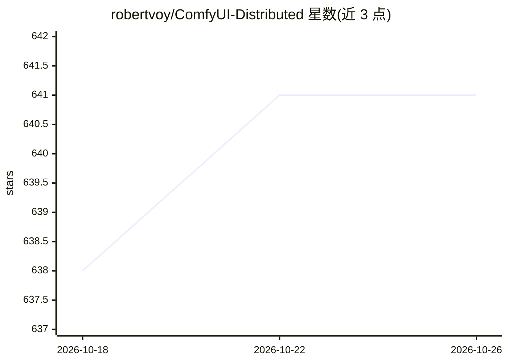

# robertvoy/ComfyUI-Distributed

⭐ 641 · Python · Apache-2.0 · 推送 2026-10-21 · [GitHub](https://github.com/robertvoy/ComfyUI-Distributed) · 个人维护

**ComfyUI 分布式扩展：跨多 GPU 与多机并行生成/放大图片视频**

ComfyUI 的 custom node 扩展，把工作流分发到多块 GPU 并行执行：支持本机多卡、局域网远程 worker、云 GPU（如 Runpod）及无服务器队列端点四类 worker。提供并行出图/出视频（各 worker 独立 seed）、Ultimate SD Upscale 分块分布式放大、图像列表并行调度等能力，通过 Distributed Seed/Collector 等节点把任意工作流改造为分布式，另有开发者 API 提交队列。限制：不合并多卡显存，不加速单张图生成；要求多块 NVIDIA GPU。

## 筛选速览

| 维度 | 判定 | 备注 |
|---|---|---|
| AI 角色 | `ai-ecosystem` | LLM/agent 周边工具 |
| 许可风险 | `permissive` | Apache-2.0 |
| 部署形态 | `None` |  |
| 模型依赖 | — | README 未给出锁定关系 |
| 硬件要求 | — | 无带数字的原话,不猜 |
| 安装摩擦 | `low` | 无编译、无系统依赖或容器化 |
| 成熟度 | — | 结构信号不足 |

## 能力要点

- 四类 worker：本机多卡、远程机器、云 GPU、Runpod 无服务器端点
- 并行工作流处理：多 GPU 不同 seed 同时出图/出视频，结果回收到主节点
- Ultimate SD Upscale 分块分布式放大，支持图片与视频
- POST /distributed/queue 开发者 API 与 orchestrator-only 模式

## 适用场景

- 用多块 GPU 并行批量出图或生成视频
- 把放大任务的分块分发给多台机器加速
- 主节点只做调度，渲染全部交给云/远程 worker

## 场景标签

`图像生成` `视频生成` · 领域:内容生成

## 证据(README 行号)

> L7: > **A powerful extension for ComfyUI that enables distributed and parallel processing across multiple GPUs and machi
> L14: - Run your workflow on multiple GPUs simultaneously with varied seeds, collect results on the master
> L30: - Convert any workflow to distributed with 2 nodes

## 星数曲线

2026-10-18 638 → 2026-10-26 641（+3）

---
*卡片 v1 · prompt 1.4 · 生成 2026-10-21 · 置信度 high · 依据 README sha `53ec369c3261` · [字段定义](../../DATASET.md)*
