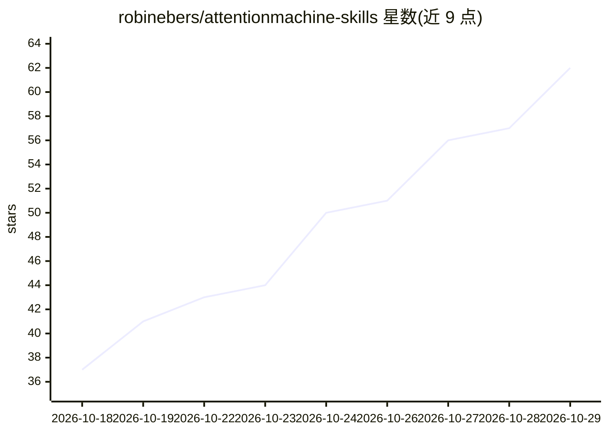

# robinebers/attentionmachine-skills

⭐ 62 · JavaScript · NOASSERTION · 推送 2026-10-15 · [GitHub](https://github.com/robinebers/attentionmachine-skills) · [官网](https://www.attentionmachine.ai) · 个人维护

**让 Claude Code/Codex 把口播录像自动剪成 Reels 的技能包**

面向内容创作者的 AI agent 技能集：安装进 Claude Code 或 Codex 后，用户交出原始录像，由 agent 完成剪辑——将最佳钩子前置、去除口误停顿、生成字幕与标题动画、模仿指定视频风格，默认输出 Reels，也可输出 YouTube/LinkedIn 格式。运行需 Claude Code 或 Codex 订阅、Node.js/ffmpeg、ElevenLabs 转录账号与 Remotion。许可为 PolyForm Internal Use，仅限自有业务使用，为客户剪辑或集成进服务需书面许可。

## 筛选速览

| 维度 | 判定 | 备注 |
|---|---|---|
| AI 角色 | `ai-ecosystem` | LLM/agent 周边工具 |
| 许可风险 | `none` | NOASSERTION |
| 部署形态 | `None` |  |
| 模型依赖 | locked-api |  |
| 硬件要求 | — | 无带数字的原话,不猜 |
| 安装摩擦 | `medium` | 含编译或系统依赖之一 |
| 成熟度 | — | 结构信号不足 |

## 能力要点

- 钩子前置、去口误停顿、防切词的自动剪辑流程
- 字幕拼写校正与标题/Logo/动画生成，可模仿指定视频风格
- 默认输出 Reels，可按需输出 YouTube/LinkedIn 格式
- 通过一段提示词安装进 Claude Code 或 Codex

## 适用场景

- 我说完一段录像，让 AI 直接剪出可发布的 Reels
- 模仿喜欢的视频风格批量产出短视频
- 不想学剪辑软件的出镜创作者日常发内容

## 场景标签

`图像视频处理` · 领域:感知与多模态

## 证据(README 行号)

> L3: Give your AI a raw recording and get back a finished Reel: hook first, rambling gone, captions on, sound ready for t
> L9: > Install The Attention Machine skills from https://github.com/robinebers/attentionmachine-skills into this folder. 

## 星数曲线

2026-10-18 37 → 2026-10-29 62（+25）

---
*卡片 v1 · prompt 1.4 · 生成 2026-10-24 · 置信度 high · 依据 README sha `400fd1e1a3c2` · [字段定义](../../DATASET.md)*
