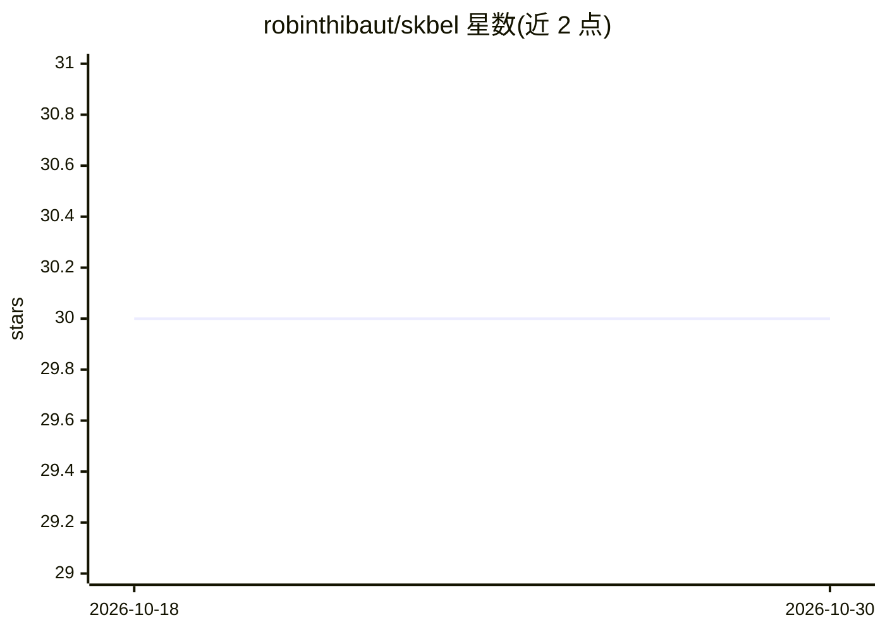

# robinthibaut/skbel

⭐ 30 · Python · BSD-3-Clause · 推送 2026-10-11 · [GitHub](https://github.com/robinthibaut/skbel) · [官网](https://skbel.readthedocs.io/) · 个人维护

**基于 scikit-learn 的贝叶斯证据学习（BEL）框架，做后验推断与实验设计**

Python 库 skbel 实现 Bayesian Evidential Learning 框架：通过预测变量与目标变量的降维、典型相关分析进行回归，并以 mvn、kde 或 transport map 三种模式做后验采样，支持按种子逐行可复现。附带校准与评分（PIT、区间覆盖率、CRPS、Brier）、测量方案排序与获取规划、设计对比评估等模块；可选 neural 扩展加入 PyTorch 高斯混合网络集成。主要面向地下水/水文地质等科学计算场景的研究者与建模者，2.3 版本需从 git tag 安装，部分功能为实验性。

## 筛选速览

| 维度 | 判定 | 备注 |
|---|---|---|
| AI 角色 | `ai-native` | 本体是模型或模型工具 |
| 许可风险 | `permissive` | BSD-3-Clause |
| 部署形态 | `library` | 以包/库形式分发 |
| 模型依赖 | — | README 未给出锁定关系 |
| 硬件要求 | — | 无带数字的原话,不猜 |
| 安装摩擦 | `low` | 无编译、无系统依赖或容器化 |
| 成熟度 | `idea` | |

## 能力要点

- BEL 主流程：降维+CCA 回归+mvn/kde/tm 三种后验采样模式
- 仿真校准、PIT/覆盖率与 CRPS/energy/Brier 后验评分
- 测量方案排序与实验设计获取规划
- 可选 neural 扩展（PyTorch 高斯混合网络集成+分位数再校准）

## 适用场景

- 在水文地质建模中做贝叶斯后验推断与不确定性量化
- 比较与评估不同测量方案（实验设计）
- 对后验分布做校准诊断与评分

## 场景标签

`科研工具` · 领域:学习与行业

## 证据(README 行号)

> L30: **skbel** is a Python module for implementing the Bayesian Evidential Learning framework built on top of
> L39: - **BEL** (``skbel.BEL``): predictor and target reduction, canonical correlation

## 星数曲线

2026-10-18 30 → 2026-10-30 30（+0）

---
*卡片 v1 · prompt 1.4 · 生成 2026-10-26 · 置信度 high · 依据 README sha `3f3992955b63` · [字段定义](../../DATASET.md)*
