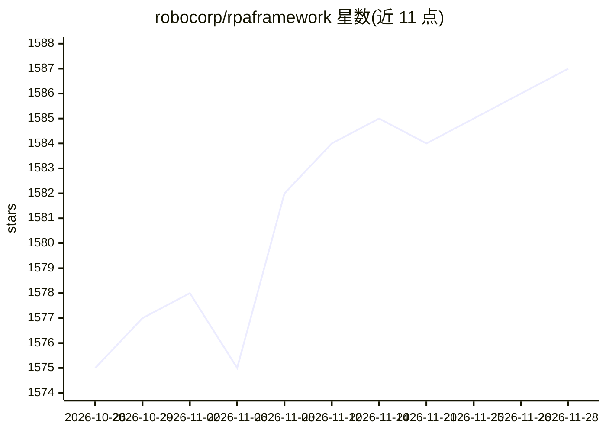

# robocorp/rpaframework

⭐ 1,587 · Python · Apache-2.0 · 推送 2026-11-20 · [GitHub](https://github.com/robocorp/rpaframework) · [官网](https://www.rpaframework.org/) · 组织维护

**面向软件机器人开发者的 RPA 自动化库集合**

RPA Framework 是 Robocorp 赞助的开源 RPA 库与工具集合，可同时用于 Robot Framework 和 Python。以多个 PyPI 包组织：核心包 rpaframework 及 assistant/aws/google/hubspot/openai/decision/pdf/recognition/windows 等扩展包，其中 core 与 recognition 为不含库的支持包。库覆盖浏览器自动化（Selenium/Playwright）、桌面与 Java 应用控制、Excel/PDF/邮件/FTP/HTTP 操作、AWS/Azure/GCP 云服务、Salesforce/SAP/HubSpot/NetSuite 等企业系统接入，以及 DocumentAI、OpenAI、Images 等文档与图像处理库。

## 筛选速览

| 维度 | 判定 | 备注 |
|---|---|---|
| AI 角色 | `ai-enhanced` | 去掉 AI 部分产品仍成立 |
| 许可风险 | `permissive` | Apache-2.0 |
| 部署形态 | `library` | 以包/库形式分发 |
| 模型依赖 | — | README 未给出锁定关系 |
| 硬件要求 | — | 无带数字的原话,不猜 |
| 安装摩擦 | `low` | 无编译、无系统依赖或容器化 |
| 成熟度 | — | 结构信号不足 |

## 能力要点

- 同时支持 Robot Framework 与 Python 两种使用方式
- 拆分为核心包加 aws/google/openai/pdf/windows 等多个 PyPI 扩展包
- 库覆盖浏览器、桌面、Excel/PDF、邮件、云服务与企业系统（SAP/Salesforce 等）
- 针对 Robocorp Control Room 与 Developer Tools 优化

## 适用场景

- 用 Robot Framework 或 Python 编写网页与桌面自动化机器人
- 在 RPA 流程中读写 Excel、PDF 与收发邮件
- 通过库调用 AWS/Azure/GCP 与 Salesforce、SAP 等企业系统
- 在自动化流程中接入 DocumentAI/OpenAI 服务处理文档

## 场景标签

`浏览器自动化` `GUI 自动化` `图像视频处理` `OCR` · 领域:效率与自动化

## 证据(README 行号)

> L11: `RPA Framework` is a collection of open-source libraries and tools for
> L22: - Optimized for Robocorp `Control Room`_ and `Developer Tools`_
> L141: |`DocumentAI`_|Intelligent Document Processing wrapper|x|

## 星数曲线

2026-10-26 1,575 → 2026-11-28 1,587（+12）

---
*卡片 v1 · prompt 1.4 · 生成 2026-11-23 · 置信度 high · 依据 README sha `318e36f23247` · [字段定义](../../DATASET.md)*
