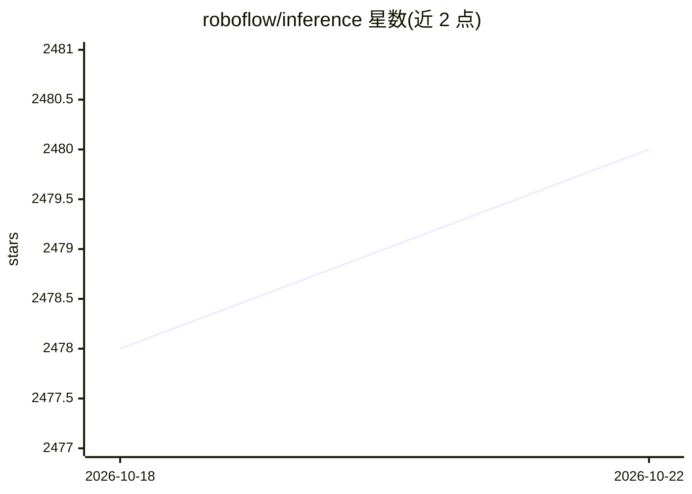

# roboflow/inference

⭐ 2,480 · Python · NOASSERTION · 推送 2026-10-22 · [GitHub](https://github.com/roboflow/inference) · [官网](https://inference.roboflow.com) · 组织维护

**自托管计算机视觉推理服务器：让相机与边缘设备运行模型**

Roboflow 维护的自托管 CV 推理服务器：通过 Docker 容器在本地或边缘设备上运行微调模型与基础模型（Florence-2、CLIP、SAM2），以可组合的 Workflows 块串联检测、分类、分割、跟踪计数、OCR 与条码识别等能力，支持 RTSP 视频流处理、GPU 加速与通知/webhook 外呼，提供 Python SDK 与 REST API 访问。核心采用 Apache 2.0 许可，企业功能与模型商业许可需另购，云端托管按图计费。

## 筛选速览

| 维度 | 判定 | 备注 |
|---|---|---|
| AI 角色 | `ai-ecosystem` | LLM/agent 周边工具 |
| 许可风险 | `none` | NOASSERTION |
| 部署形态 | `self-host` | docker 或自建部署 |
| 模型依赖 | — | README 未给出锁定关系 |
| 硬件要求 | — | 无带数字的原话,不猜 |
| 安装摩擦 | `low` | 无编译、无系统依赖或容器化 |
| 成熟度 | — | 结构信号不足 |

## 能力要点

- Workflows 可组合块串联模型检测/分类/分割/跟踪计数等能力
- 支持 Florence-2、CLIP、SAM2 等基础模型与自有微调模型
- RTSP 视频流处理、GPU 加速、通知与 webhook 外呼
- 覆盖 Linux/Windows/Mac/Jetson/树莓派等设备，提供 Python SDK 与 REST API

## 适用场景

- 在自有硬件上部署目标检测/车牌识别等视觉工作流
- 对实时视频流做目标跟踪、计数与区域停留分析
- 将 ML 与 OCR/条码/QR 等传统 CV 方法组合成微服务

## 场景标签

`推理引擎` `目标检测` `OCR` `图像视频处理` · 领域:感知与多模态

## 证据(README 行号)

> L17: Inference turns any computer or edge device into a command center for your computer vision projects.
> L57: A key component of Inference is Workflows, composable blocks of common functionality that give models a common inte
> L112: Once you've installed Inference, your machine is a fully-featured CV center.

## 星数曲线

2026-10-18 2,478 → 2026-10-22 2,480（+2）

---
*卡片 v1 · prompt 1.4 · 生成 2026-10-21 · 置信度 high · 依据 README sha `7abe4861ee38` · [字段定义](../../DATASET.md)*
