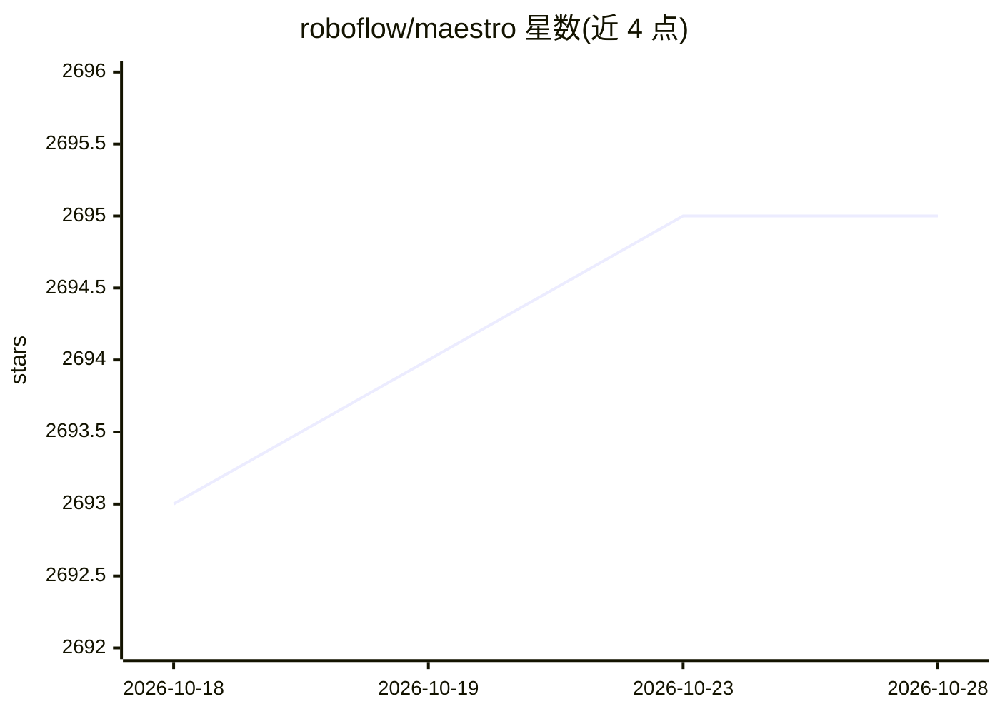

# roboflow/maestro

⭐ 2,695 · Python · Apache-2.0 · 推送 2026-10-26 · [GitHub](https://github.com/roboflow/maestro) · [官网](https://maestro.roboflow.com) · 组织维护

**多模态视觉语言模型（Florence-2/PaliGemma 2/Qwen2.5-VL）微调工具**

Roboflow 维护的多模态模型微调工具：封装配置、数据加载、可复现性与训练循环，为 Florence-2、PaliGemma 2、Qwen2.5-VL 提供即用微调配方，支持 LoRA、QLoRA 与图冻结等优化策略以控制硬件需求。提供单一 CLI 与 Python SDK 两种入口，采用统一的 JSONL 数据格式；提供多个模型/任务的免费 Colab notebook。建议为每个模型创建独立 Python 环境以避免依赖冲突，部分配方标注为实验性。

## 筛选速览

| 维度 | 判定 | 备注 |
|---|---|---|
| AI 角色 | `ai-ecosystem` | LLM/agent 周边工具 |
| 许可风险 | `permissive` | Apache-2.0 |
| 部署形态 | `library` | 以包/库形式分发 |
| 模型依赖 | — | README 未给出锁定关系 |
| 硬件要求 | — | 无带数字的原话,不猜 |
| 安装摩擦 | `low` | 无编译、无系统依赖或容器化 |
| 成熟度 | `idea` | |

## 能力要点

- Florence-2、PaliGemma 2、Qwen2.5-VL 的即用微调配方
- 支持 LoRA、QLoRA、图冻结优化策略
- 单一 CLI/SDK 入口与统一 JSONL 数据格式
- 提供多个免费 Colab 微调 notebook（目标检测、JSON 数据抽取）

## 适用场景

- 用自己的数据集微调视觉语言模型做目标检测
- 微调 VLM 完成 JSON 格式数据抽取任务
- 在 Colab 免费资源上完成 LoRA/QLoRA 微调

## 场景标签

`微调` `目标检测` · 领域:感知与多模态

## 证据(README 行号)

> L30: **maestro** is a streamlined tool to accelerate the fine-tuning of multimodal models.
> L47: - `2025/02/05` (`1.0.0`): This release introduces support for Florence-2, PaliGemma 2, and Qwen2.5-VL and includes 

## 星数曲线

2026-10-18 2,693 → 2026-10-28 2,695（+2）

---
*卡片 v1 · prompt 1.4 · 生成 2026-10-21 · 置信度 high · 依据 README sha `b9224a44c81a` · [字段定义](../../DATASET.md)*
