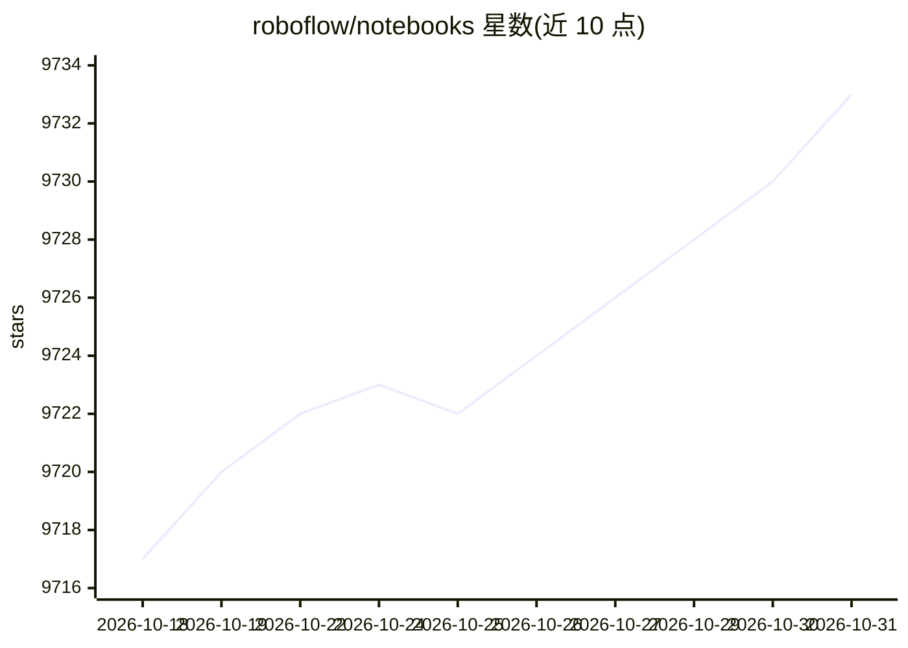

# roboflow/notebooks

⭐ 9,733 · Jupyter Notebook · 推送 2026-09-22 · [GitHub](https://github.com/roboflow/notebooks) · [官网](https://roboflow.com/models) · 组织维护

**计算机视觉模型教程笔记本合集（88+ 本）**

Roboflow 维护的计算机视觉教程笔记本集合：61 本模型教程覆盖 RF-DETR、YOLO 系列、SAM/SAM2/SAM3、PaliGemma、Florence-2、Qwen-VL、Grounding DINO、CLIP 等模型的推理与微调；另含 4 本目标跟踪教程（ByteTrack/SORT/OC-SORT 等）和 23 本技能笔记本（自动标注、车辆测速、图像检索等）。每本笔记本可在 Colab、Kaggle、SageMaker Studio Lab 打开，多数附论文与 GitHub 链接；也提供本地运行说明（git clone + venv）。

## 筛选速览

| 维度 | 判定 | 备注 |
|---|---|---|
| AI 角色 | `ai-knowledge` | 知识聚合/清单类 |
| 许可风险 | `none` | — |
| 部署形态 | `None` |  |
| 模型依赖 | — | README 未给出锁定关系 |
| 硬件要求 | — | 无带数字的原话,不猜 |
| 安装摩擦 | `low` | 无编译、无系统依赖或容器化 |
| 成熟度 | — | 结构信号不足 |

## 能力要点

- 61 本模型教程，覆盖检测/分割/分类/姿态/OCR/数据抽取等任务
- 每本笔记本支持 Colab / Kaggle / SageMaker Studio Lab 一键打开
- 附跟踪教程与自动标注、零标注训练等技能笔记本
- 条目关联论文 arXiv、GitHub 仓库与配套视频

## 适用场景

- 学习和试用最新的计算机视觉模型（如 SAM 3、RF-DETR）
- 在自有数据集上微调检测/分割/分类模型
- 跟随笔记本完成自动数据标注与模型评测

## 场景标签

`教程课程` · 领域:学习与行业

## 证据(README 行号)

> L54: This repository offers a growing collection of computer vision tutorials. Learn to use SOTA models like YOLOv11, SA
> L56: ## 🚀 model tutorials (61 notebooks)
> L127: ## 🛠️ computer vision skills (23 notebooks)

## 星数曲线

2026-10-18 9,717 → 2026-10-31 9,733（+16）

---
*卡片 v1 · prompt 1.4 · 生成 2026-10-20 · 置信度 high · 依据 README sha `bac2d8a3a609` · [字段定义](../../DATASET.md)*
