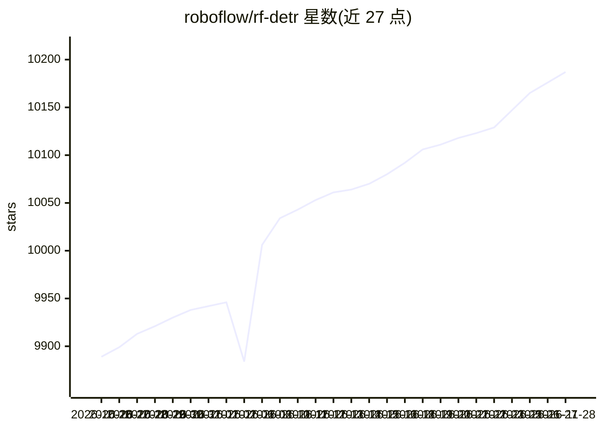

# roboflow/rf-detr

⭐ 10,187 · Python · Apache-2.0 · 推送 2026-11-27 · [GitHub](https://github.com/roboflow/rf-detr) · [官网](https://rfdetr.roboflow.com) · 组织维护

**面向开发者的实时目标检测/分割/关键点检测模型**

Roboflow 开发的实时 transformer 检测模型架构，基于 DINOv2/PE-Core-T 视觉骨干，统一 API 下支持目标检测、实例分割与关键点检测（预览），提供 Nano 到 2XLarge 多种尺寸，设计目标为可微调。以 Python 包 rfdetr 发布，pip 安装；部分尺寸（Atto/Femto/Pico/XL/2XL）位于可选 rfdetr[plus] 扩展，采用 Roboflow PML 1.0 许可，自托管商用需 Enterprise 附加项。README 提供 COCO 与 RF100-VL 基准数据、运行示例代码及 Inference 库运行方式。

## 筛选速览

| 维度 | 判定 | 备注 |
|---|---|---|
| AI 角色 | `ai-native` | 本体是模型或模型工具 |
| 许可风险 | `permissive` | Apache-2.0 |
| 部署形态 | `library` | 以包/库形式分发 |
| 模型依赖 | — | README 未给出锁定关系 |
| 硬件要求 | — | 无带数字的原话,不猜 |
| 安装摩擦 | `low` | 无编译、无系统依赖或容器化 |
| 成熟度 | — | 结构信号不足 |

## 能力要点

- 单一 API 支持检测、实例分割与关键点检测（预览）三种任务
- 提供 Nano 到 2XLarge 多种模型尺寸，基于神经架构搜索生成
- 核心尺寸与代码采用 Apache 2.0 许可，部分尺寸在 rfdetr[plus] 扩展下为 PML 1.0
- 可通过 rfdetr 包或 Inference 库运行，附带 COCO/RF100-VL 基准表

## 适用场景

- 微调自定义数据集做实时目标检测
- 图像实例分割任务
- 人体关键点/姿态检测
- 在闭源商业产品中自托管部署检测模型

## 场景标签

`目标检测` `微调` · 领域:感知与多模态

## 证据(README 行号)

> L13: RF-DETR is a real-time transformer architecture for object detection, instance segmentation, and keypoint detection
> L15: RF-DETR supports object detection, instance segmentation, and keypoint detection (preview) in a single, consistent 

## 星数曲线

2026-10-26 9,889 → 2026-11-28 10,187（+298）

---
*卡片 v1 · prompt 1.4 · 生成 2026-11-26 · 置信度 high · 依据 README sha `538fffd3a655` · [字段定义](../../DATASET.md)*
