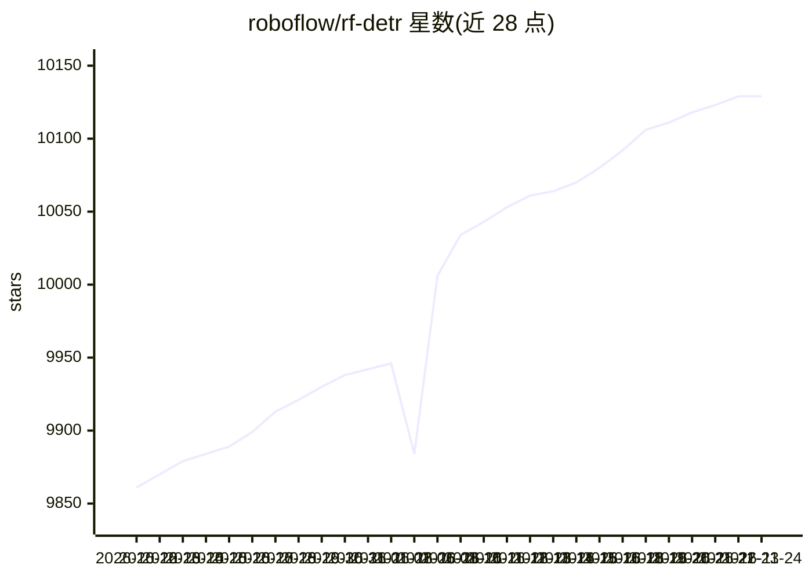

# roboflow/rf-detr

⭐ 10,147 · Python · Apache-2.0 · 推送 2026-11-24 · [GitHub](https://github.com/roboflow/rf-detr) · [官网](https://rfdetr.roboflow.com) · 组织维护

**面向微调场景的实时目标检测与分割模型**

Roboflow 开发的实时 transformer 检测架构，单一 API 覆盖目标检测、实例分割与关键点检测（预览），基于 DINOv2/PE-Core-T 主干，提供从 Atto 到 2XLarge 的多个尺寸，并给出 COCO 与 RF100-VL 上的精度-延迟基准。通过 rfdetr 包（pip）安装运行，支持用自有数据集微调；部分模型尺寸在 rfdetr[plus] 扩展中，按 PML 1.0 许可发布，在 Roboflow 平台部署含商业使用，自托管商用需 Enterprise 附加项。

## 筛选速览

| 维度 | 判定 | 备注 |
|---|---|---|
| AI 角色 | `ai-native` | 本体是模型或模型工具 |
| 许可风险 | `permissive` | Apache-2.0 |
| 部署形态 | `library` | 以包/库形式分发 |
| 模型依赖 | — | README 未给出锁定关系 |
| 硬件要求 | — | 无带数字的原话,不猜 |
| 安装摩擦 | `low` | 无编译、无系统依赖或容器化 |
| 成熟度 | — | 结构信号不足 |

## 能力要点

- 单一 API 支持目标检测、实例分割与关键点检测（预览）
- 多个模型尺寸（Atto 至 2XLarge），部分由神经架构搜索生成
- 在 COCO 与 RF100-VL 上发布精度与延迟基准（NVIDIA T4/TensorRT/FP16）
- 提供 Roboflow 平台上的 NAS 训练入口

## 适用场景

- 对自定义数据集微调目标检测模型
- 实时目标检测与实例分割推理
- 在 COCO 与 RF100-VL 指标间横向比较实时检测模型

## 场景标签

`目标检测` `微调` · 领域:感知与多模态

## 证据(README 行号)

> L13: RF-DETR is a real-time transformer architecture for object detection, instance segmentation, and keypoint detection
> L15: RF-DETR supports object detection, instance segmentation, and keypoint detection (preview) in a single, consistent 
> L25: To install RF-DETR, install the `rfdetr` package in a **Python>=3.10** environment with `pip`.

## 星数曲线

2026-10-22 9,861 → 2026-11-24 10,129（+268）

---
*卡片 v1 · prompt 1.4 · 生成 2026-11-22 · 置信度 high · 依据 README sha `7340c68d2c31` · [字段定义](../../DATASET.md)*
