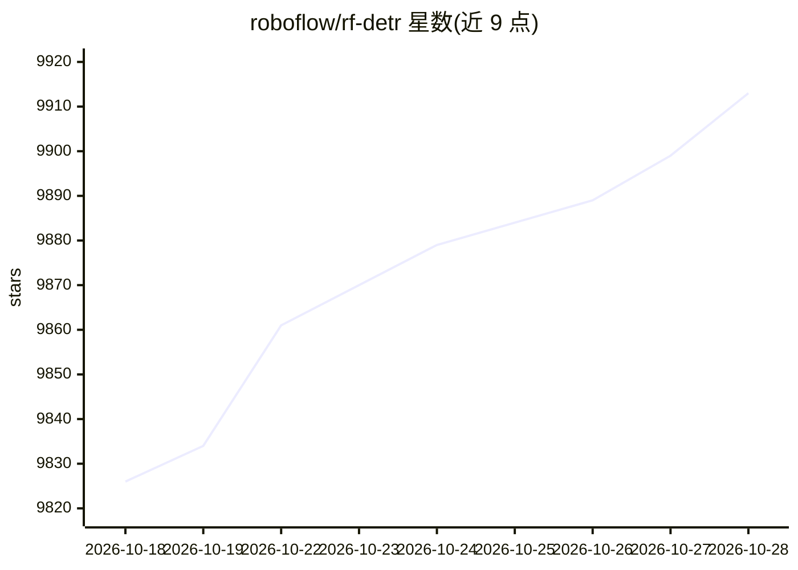

# roboflow/rf-detr

⭐ 9,921 · Python · Apache-2.0 · 推送 2026-10-28 · [GitHub](https://github.com/roboflow/rf-detr) · [官网](https://rfdetr.roboflow.com) · 组织维护

**实时目标检测/实例分割/关键点检测模型，面向微调部署**

Roboflow 开发的实时 transformer 检测架构，基于 DINOv2 视觉骨干（Atto/Femto/Pico 用 PE-Core-T），在单一 API 中支持目标检测、实例分割与关键点检测（preview），提供 Nano 至 2XLarge 多档模型规模。核心 rfdetr 包与 Apache 指定模型以 Apache 2.0 发布，Plus 组件（rfdetr_plus，含 Atto/Femto/Pico/XL/2XL）以 PML 1.0 许可。README 给出 COCO 与 RF100-VL 基准，并支持通过 Inference 库运行。

## 筛选速览

| 维度 | 判定 | 备注 |
|---|---|---|
| AI 角色 | `ai-native` | 本体是模型或模型工具 |
| 许可风险 | `permissive` | Apache-2.0 |
| 部署形态 | `library` | 以包/库形式分发 |
| 模型依赖 | — | README 未给出锁定关系 |
| 硬件要求 | — | 无带数字的原话,不猜 |
| 安装摩擦 | `low` | 无编译、无系统依赖或容器化 |
| 成熟度 | — | 结构信号不足 |

## 能力要点

- 检测、实例分割、关键点检测（preview）单一一致 API
- 基于 DINOv2 backbone，模型规模从 Nano 到 2XLarge
- 核心包 Apache 2.0，Plus 组件 PML 1.0 分许可
- 可通过 Inference 库或 rfdetr 包运行

## 适用场景

- 在自己的数据集上微调目标检测模型
- 需要实例分割或关键点检测的视觉应用
- 按延迟预算选择不同规模的检测模型部署

## 场景标签

`目标检测` `微调` · 领域:感知与多模态

## 证据(README 行号)

> L13: RF-DETR is a real-time transformer architecture for object detection, instance segmentation, and keypoint detection
> L15: RF-DETR uses a DINOv2 vision transformer backbone (PE-Core-T for Atto, Femto and Pico) and supports object detectio

## 星数曲线

2026-10-18 9,826 → 2026-10-28 9,913（+87）

---
*卡片 v1 · prompt 1.4 · 生成 2026-10-20 · 置信度 high · 依据 README sha `794a1de36408` · [字段定义](../../DATASET.md)*
