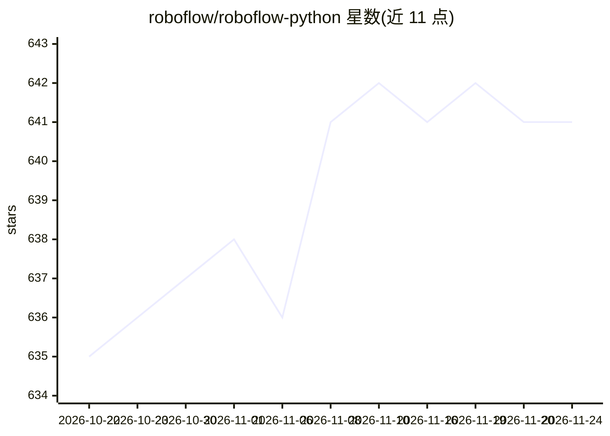

# roboflow/roboflow-python

⭐ 641 · Python · Apache-2.0 · 推送 2026-11-20 · [GitHub](https://github.com/roboflow/roboflow-python) · [官网](https://docs.roboflow.com/python) · 组织维护

**Roboflow 官方 Python SDK：管理视觉数据集与模型部署**

Roboflow 平台的官方 Python 客户端包，围绕 Workspace/Project/Version 三层对象组织：创建与管理项目、上传图像与标注、生成带预处理和增强设置的数据集版本、在 Roboflow 云端训练视觉模型，以及对托管模型或经 Roboflow Inference 自托管的模型执行推理。支持 CLI 命令行操作、API key 或登录认证，并提供 EU 数据驻留区域登录（app.roboflow.eu）。另提供轻量包 roboflow-slim，跳过 OpenCV 等重依赖，适用于嵌入式设备与 CI 环境。

## 筛选速览

| 维度 | 判定 | 备注 |
|---|---|---|
| AI 角色 | `ai-ecosystem` | LLM/agent 周边工具 |
| 许可风险 | `permissive` | Apache-2.0 |
| 部署形态 | `library` | 以包/库形式分发 |
| 模型依赖 | — | README 未给出锁定关系 |
| 硬件要求 | — | 无带数字的原话,不猜 |
| 安装摩擦 | `low` | 无编译、无系统依赖或容器化 |
| 成熟度 | — | 结构信号不足 |

## 能力要点

- 数据集管理：上传图像与标注、生成带预处理/增强的版本并按任意模型格式导出
- 云端训练与部署：在 Roboflow 上训练版本模型，或部署外部自有模型
- 推理调用：支持托管模型与通过 Roboflow Inference 自托管的模型
- CLI 命令行工具与搜索导出（如 roboflow search-export 输出 COCO 格式）

## 适用场景

- 统一管理计算机视觉项目的数据集、版本与标注
- 在云端训练视觉模型并部署推理服务
- 跨工作区搜索图像并导出为训练数据集
- 以主动学习方式将一个项目的预测结果上传到新项目

## 场景标签

 · 领域:计算机视觉/机器学习平台

## 证据(README 行号)

> L17: Roboflow provides everything you need to build and deploy computer vision models. `roboflow-python` is the official
> L24: 4. Run inference on models hosted on Roboflow, or Roboflow models self-hosted via Roboflow Inference, and more.
> L146: The Roboflow Python library is structured using the same Workspace, Project, and Version ontology that you will se

## 星数曲线

2026-10-22 635 → 2026-11-24 641（+6）

---
*卡片 v1 · prompt 1.4 · 生成 2026-11-24 · 置信度 high · 依据 README sha `54688983d369` · [字段定义](../../DATASET.md)*
