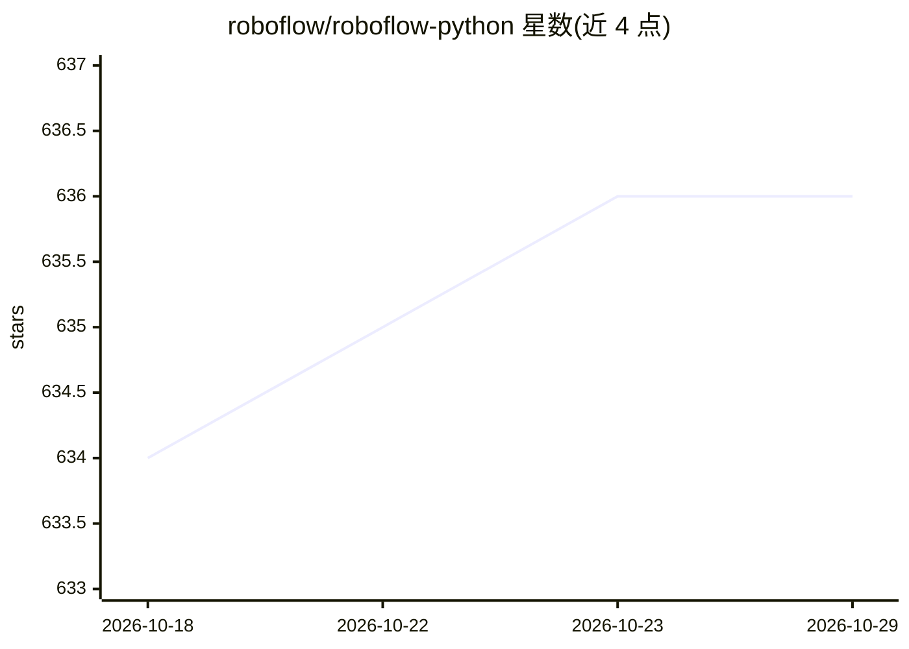

# roboflow/roboflow-python

⭐ 636 · Python · Apache-2.0 · 推送 2026-10-28 · [GitHub](https://github.com/roboflow/roboflow-python) · [官网](https://docs.roboflow.com/python) · 组织维护

**Roboflow 官方 Python 包：管理视觉数据集、模型训练与推理部署**

面向 Roboflow 平台的官方 Python 客户端：认证后可创建与管理项目、上传图像/标注/数据集、在 Roboflow 上启动视觉模型训练、对托管或自托管（Roboflow Inference）模型运行推理。库结构沿用 Workspace/Project/Version 三层本体，支持数据集版本生成、多格式导出、外部模型部署与主动学习，另提供 CLI 与 EU 数据驻留区域选项。安装提供标准、desktop/heic 扩展及跳过 OpenCV 等重依赖的 roboflow-slim 轻量版（约 50MB）。

## 筛选速览

| 维度 | 判定 | 备注 |
|---|---|---|
| AI 角色 | `ai-ecosystem` | LLM/agent 周边工具 |
| 许可风险 | `permissive` | Apache-2.0 |
| 部署形态 | `library` | 以包/库形式分发 |
| 模型依赖 | — | README 未给出锁定关系 |
| 硬件要求 | — | 无带数字的原话,不猜 |
| 安装摩擦 | `low` | 无编译、无系统依赖或容器化 |
| 成熟度 | — | 结构信号不足 |

## 能力要点

- Workspace/Project/Version 三层结构管理项目、数据集版本与训练
- 支持对 Roboflow 托管或自托管 Inference 模型运行推理
- CLI 覆盖搜索导出、认证等常用功能（roboflow search-export）
- roboflow-slim 轻量安装从约 400MB 降至约 50MB，适合嵌入式/CI/无服务器环境

## 适用场景

- 用 Python 脚本批量上传图像与标注并生成数据集版本
- 在 Roboflow 平台启动训练并下载各模型格式的数据集
- 对托管模型运行预测并集成到视觉应用中

## 场景标签

`模型训练` `目标检测` · 领域:感知与多模态

## 证据(README 行号)

> L17: Roboflow provides everything you need to build and deploy computer vision models. `roboflow-python` is the official
> L23: 3. Start training vision models on Roboflow;
> L24: 4. Run inference on models hosted on Roboflow, or Roboflow models self-hosted via Roboflow Inference, and more.

## 星数曲线

2026-10-18 634 → 2026-10-29 636（+2）

---
*卡片 v1 · prompt 1.4 · 生成 2026-10-21 · 置信度 high · 依据 README sha `49f3412ce4f4` · [字段定义](../../DATASET.md)*
