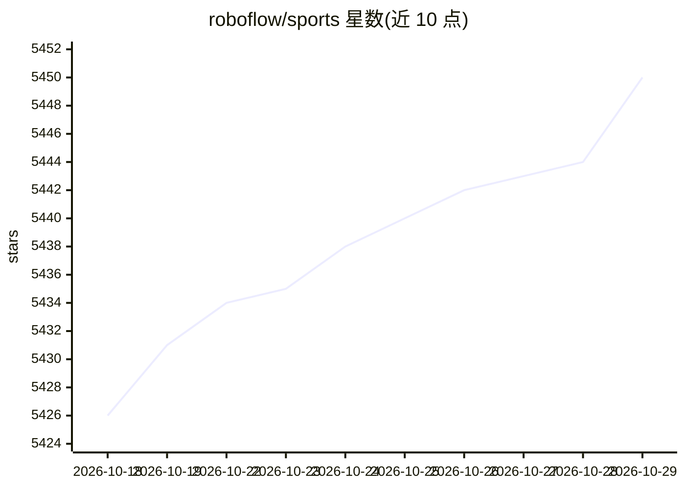

# roboflow/sports

⭐ 5,450 · Python · MIT · 推送 2026-08-28 · [GitHub](https://github.com/roboflow/sports) · 组织维护

**面向体育场景的计算机视觉工具与数据集集合**

Roboflow 维护的体育计算机视觉开源仓库，提供可复用的工具与数据集链接，覆盖足球/篮球的球员检测、球跟踪、球场关键点检测、球衣号码 OCR 等用例。README 列出球跟踪、球员重识别、摄像机标定等挑战方向，包含 notebooks、inference、autodistill、maestro 等目录。尚未发布 Python 包，需在 Python>=3.8 环境从源码安装，数据集托管于 Roboflow Universe。

## 筛选速览

| 维度 | 判定 | 备注 |
|---|---|---|
| AI 角色 | `ai-ecosystem` | LLM/agent 周边工具 |
| 许可风险 | `permissive` | MIT |
| 部署形态 | `library` | 以包/库形式分发 |
| 模型依赖 | — | README 未给出锁定关系 |
| 硬件要求 | — | 无带数字的原话,不猜 |
| 安装摩擦 | `low` | 无编译、无系统依赖或容器化 |
| 成熟度 | — | 结构信号不足 |

## 能力要点

- 足球球员/球检测、球场关键点检测、篮球球衣号码 OCR 等数据集链接
- 覆盖球跟踪、球员重识别、摄像机标定等分析挑战的说明
- 提供演示视频与 notebooks/inference/autodistill/maestro 目录

## 适用场景

- 查找体育视觉任务的数据集与工具
- 做足球球员检测或球场关键点检测的二次开发
- 参与体育分析开源工具共建

## 场景标签

`目标检测` `图像视频处理` `OCR` · 领域:感知与多模态

## 证据(README 行号)

> L7: In sports, every centimeter and every second matter. That's why Roboflow decided to use sports as a testing ground t
> L30: |use case|dataset|

## 星数曲线

2026-10-18 5,426 → 2026-10-29 5,450（+24）

---
*卡片 v1 · prompt 1.4 · 生成 2026-10-20 · 置信度 mid · 依据 README sha `865e35c3d3e1` · [字段定义](../../DATASET.md)*
