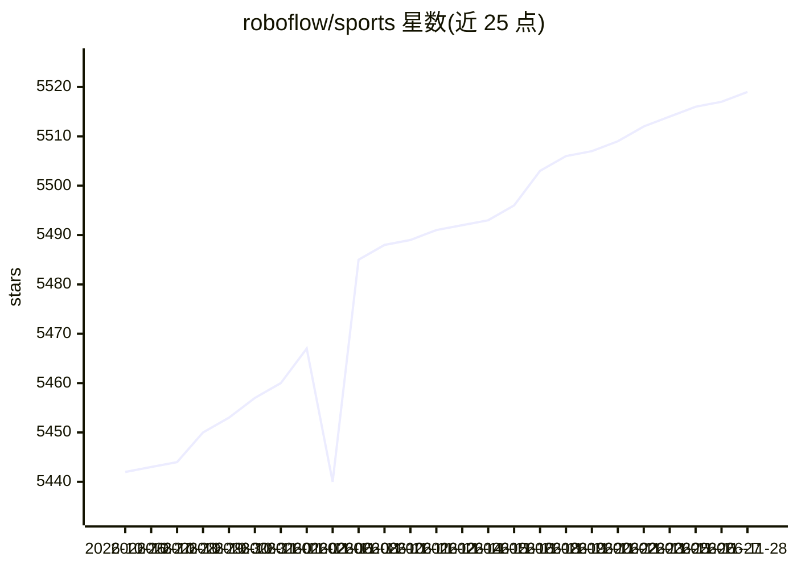

# roboflow/sports

⭐ 5,519 · Python · MIT · 推送 2026-11-27 · [GitHub](https://github.com/roboflow/sports) · 组织维护

**面向体育分析的可复用计算机视觉工具库**

Roboflow 维护的体育场景计算机视觉工具库，将目标检测、图像分割、关键点检测与基础模型应用于足球、篮球等运动，并提供可在体育之外复用的工具。列出五个核心挑战：球体追踪、球衣号码识别、球员追踪、球员重识别与相机标定。随附五类公开数据集（球员/球检测、球场关键点、球衣号码 OCR），需 Python 3.11+ 从源码安装，测试用 uv 运行。

## 筛选速览

| 维度 | 判定 | 备注 |
|---|---|---|
| AI 角色 | `ai-native` | 本体是模型或模型工具 |
| 许可风险 | `permissive` | MIT |
| 部署形态 | `library` | 以包/库形式分发 |
| 模型依赖 | — | README 未给出锁定关系 |
| 硬件要求 | — | 无带数字的原话,不猜 |
| 安装摩擦 | `low` | 无编译、无系统依赖或容器化 |
| 成熟度 | — | 结构信号不足 |

## 能力要点

- 覆盖球体追踪、球员追踪/重识别、球衣号码 OCR、相机标定五类体育 CV 挑战
- 提供五类体育数据集（足球球员/球检测、球场与篮球场关键点、球衣号码 OCR）
- 基于 Roboflow 自有的检测、分割与关键点检测模型构建

## 适用场景

- 对足球/篮球比赛视频做球员与球体检测追踪
- 用关键点检测做球场相机标定以计算球员速度与距离
- 下载体育领域检测/OCR 数据集做训练与实验

## 场景标签

`目标检测` · 领域:感知与多模态

## 证据(README 行号)

> L7: In sports, every centimeter and every second matter. That's why Roboflow decided to use sports as a testing ground t
> L13: - **Ball tracking:** Tracking the ball is extremely difficult due to its small size and rapid movements, especially
> L21: Install from source with Python 3.11 or newer.

## 星数曲线

2026-10-26 5,442 → 2026-11-28 5,519（+77）

---
*卡片 v1 · prompt 1.4 · 生成 2026-11-28 · 置信度 high · 依据 README sha `0603654966e4` · [字段定义](../../DATASET.md)*
