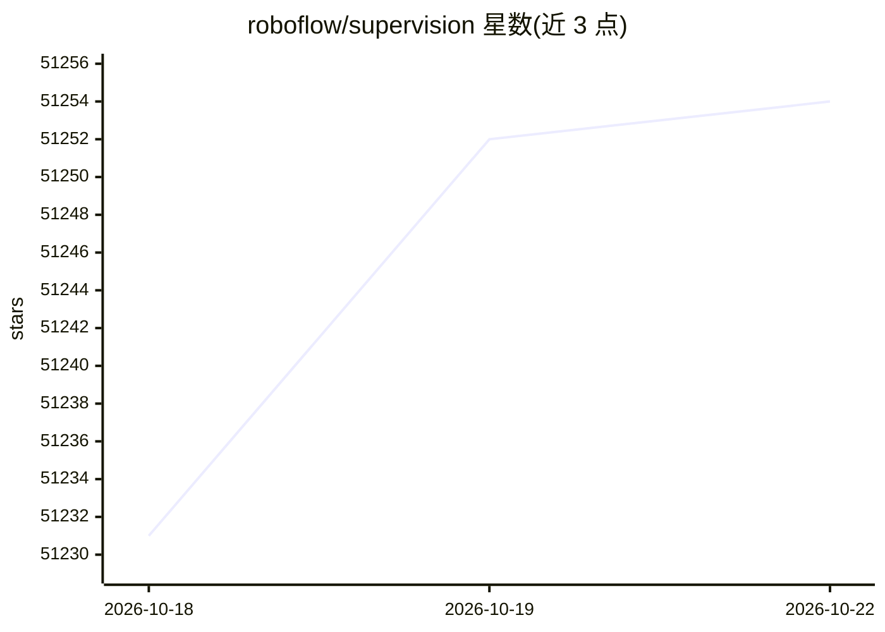

# roboflow/supervision

⭐ 51,254 · Python · MIT · 推送 2026-10-21 · [GitHub](https://github.com/roboflow/supervision) · [官网](https://supervision.roboflow.com) · 组织维护

**计算机视觉开发者的可复用工具集：模型接入、标注、数据集处理**

面向计算机视觉应用的 Python 工具库：提供模型无关的检测/分类/分割结果封装（sv.Detections），内置 Ultralytics、Transformers、MMDetection、Inference、rfdetr 等库的连接器；提供可自定义的图像标注器，以及 YOLO 等（含 COCO）格式的数据集加载、拆分、合并、转换与保存工具。需 Python>=3.10，通过 pip 安装，含教程与文档。使用 Inference 模型需 Roboflow API KEY。

## 筛选速览

| 维度 | 判定 | 备注 |
|---|---|---|
| AI 角色 | `ai-ecosystem` | LLM/agent 周边工具 |
| 许可风险 | `permissive` | MIT |
| 部署形态 | `library` | 以包/库形式分发 |
| 模型依赖 | — | README 未给出锁定关系 |
| 硬件要求 | — | 无带数字的原话,不猜 |
| 安装摩擦 | `low` | 无编译、无系统依赖或容器化 |
| 成熟度 | — | 结构信号不足 |

## 动量与使用信号

- 维护:`active` — 距上次 push 1.1 天,年发版 17,210 位贡献者
- 涨星:近 1 天 **+8**(自 20261016 起算)
- 安装:pypi 包 `supervision` 月下载 839,145

## 能力要点

- 模型无关设计，内置多框架检测结果连接器
- 高度可自定义的图像标注器
- 数据集加载、拆分、合并、格式转换与保存工具
- 提供区域计数、跟踪、速度估计等教程

## 适用场景

- 接入自选检测/分割模型并可视化标注结果
- 在 YOLO、COCO 等格式间转换与拆分数据集
- 做区域驻留时间分析、车辆跟踪测速等应用

## 场景标签

`目标检测` `图像视频处理` · 领域:感知与多模态

## 证据(README 行号)

> L22: **We are your essential toolkit for computer vision.** From data loading to real-time zone counting, we provide the
> L38: Supervision was designed to be model agnostic. Just plug in any classification, detection, or segmentation model. F

## 星数曲线

2026-10-18 51,231 → 2026-10-22 51,254（+23）

---
*卡片 v1 · prompt 1.4 · 生成 2026-10-18 · 置信度 high · 依据 README sha `6bc64dfd7ac5` · [字段定义](../../DATASET.md)*
