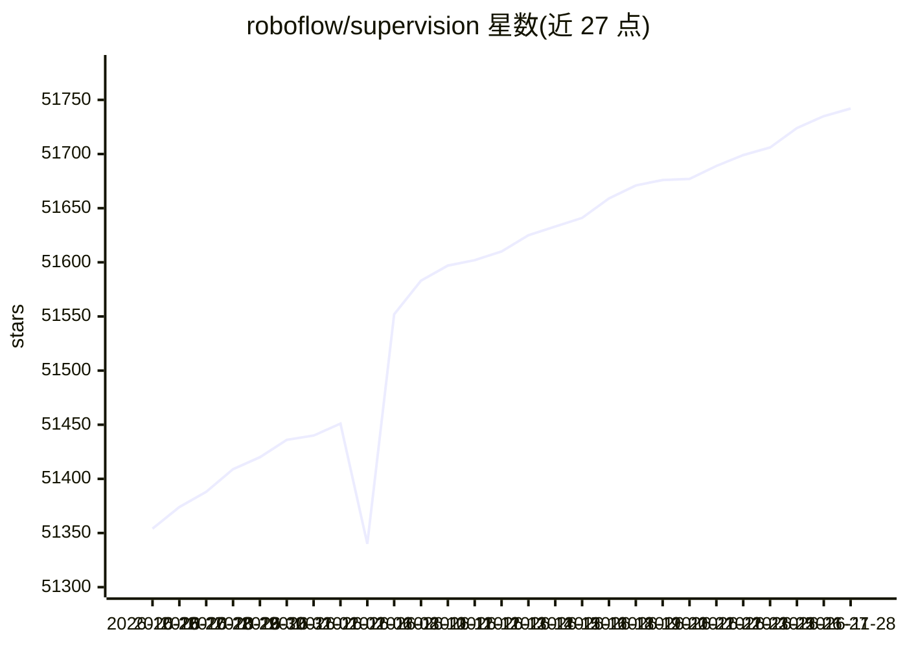

# roboflow/supervision

⭐ 51,742 · Python · MIT · 推送 2026-11-27 · [GitHub](https://github.com/roboflow/supervision) · [官网](https://supervision.roboflow.com) · 组织维护

**给 CV 开发者的可复用工具库：检测标注、数据集处理与计数追踪**

面向计算机视觉应用的 Python 工具集，定位为模型无关（model agnostic）：接入任意分类、检测或分割模型，为 Ultralytics、Transformers、MMDetection、Inference 等流行库提供连接器，rfdetr 等直接返回 sv.Detections。功能覆盖：可自定义的图像标注器（annotators）、数据集的加载/拆分/合并/保存/格式转换（YOLO、COCO 等）、区域计数、目标追踪与速度估计。要求 Python>=3.10，pip 安装，附带教程、手册与示例工程。使用 Inference 运行模型需要 Roboflow API KEY。

## 筛选速览

| 维度 | 判定 | 备注 |
|---|---|---|
| AI 角色 | `ai-native` | 本体是模型或模型工具 |
| 许可风险 | `permissive` | MIT |
| 部署形态 | `library` | 以包/库形式分发 |
| 模型依赖 | — | README 未给出锁定关系 |
| 硬件要求 | — | 无带数字的原话,不猜 |
| 安装摩擦 | `low` | 无编译、无系统依赖或容器化 |
| 成熟度 | — | 结构信号不足 |

## 动量与使用信号

- 维护:`active` — 距上次 push 1.1 天,年发版 17,210 位贡献者
- 涨星:近 1 天 **+8**(自 20261016 起算)
- 安装:pypi 包 `supervision` 月下载 839,145

## 能力要点

- 模型无关连接器：适配 Ultralytics、Transformers、MMDetection、Inference 等
- 高度可自定义的检测框/分割掩码标注器
- 数据集工具：加载、拆分、合并、保存与格式转换（YOLO/COCO）
- 区域计数、多目标追踪与速度估计等应用构建块

## 适用场景

- 把自选检测模型的输出可视化标注到视频流上
- 在 YOLO/COCO 等标注格式之间转换、拆分和合并数据集
- 实现实时区域人流计数、停留时长分析或车辆测速应用
- 跟着教程学习目标检测、追踪与流处理的端到端流程

## 场景标签

`目标检测` `教程课程` · 领域:学习与行业

## 证据(README 行号)

> L22: **We are your essential toolkit for computer vision.** From data loading to real-time zone counting, we provide the
> L38: Supervision was designed to be model agnostic. Just plug in any classification, detection, or segmentation model. F
> L77: Supervision provides a set of utils that allow you to load, split, merge, and save datasets in one of the supported

## 星数曲线

2026-10-26 51,354 → 2026-11-28 51,742（+388）

---
*卡片 v1 · prompt 1.4 · 生成 2026-11-22 · 置信度 high · 依据 README sha `1339df39ac85` · [字段定义](../../DATASET.md)*
