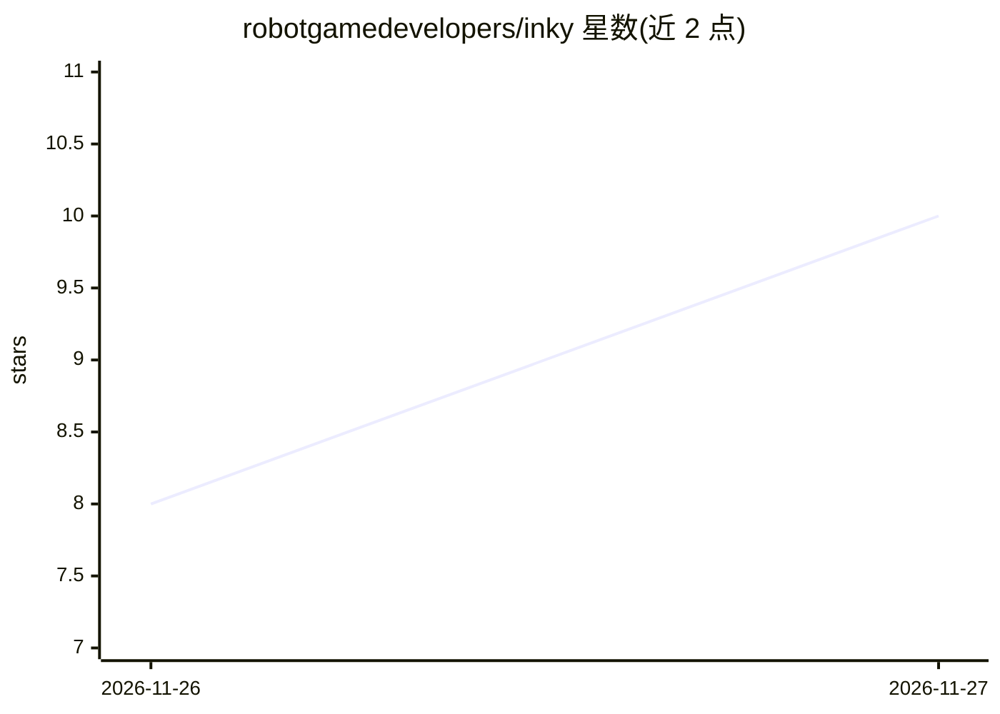

# robotgamedevelopers/inky

⭐ 10 · Rust · GPL-3.0 · 推送 2026-11-26 · [GitHub](https://github.com/robotgamedevelopers/inky) · 组织维护

**在 Apple 芯片上本地运行 Inkling 2 Mini 的推理引擎**

为 Thinking Machines 的 Inkling 2 Mini 模型提供 Apple silicon 上的本地推理：可从 LM Studio GGUF 加载运行，单进程内支持多达 64 条并行 lane，通过 HTTP 同时服务多个 coding-agent 任务，并在内存与 SSD 上共享缓存的前缀提示。数值上与 llama.cpp 的 argmax 输出做了一致性校验（KL ≤ 0.01）。项目由 erisinky fork 而来，构建与验证套件的说明位于 docs/CONTRIBUTING.md。

## 筛选速览

| 维度 | 判定 | 备注 |
|---|---|---|
| AI 角色 | `ai-native` | 本体是模型或模型工具 |
| 许可风险 | `viral` | GPL-3.0 |
| 部署形态 | `None` |  |
| 模型依赖 | — | README 未给出锁定关系 |
| 硬件要求 | — | 无带数字的原话,不猜 |
| 安装摩擦 | `low` | 无编译、无系统依赖或容器化 |
| 成熟度 | — | 结构信号不足 |

## 能力要点

- 单 lane 解码 95–106 tok/s，prefill 4,186–4,531 tok/s（M5 Max）
- 64 并行 lane 下 20K 上下文吞吐 323–434 tok/s
- 与 llama.cpp argmax 一致性校验（58/58、24/24 等 CI 检查点）
- 单进程 HTTP 服务多任务，共享前缀缓存于内存与 SSD

## 适用场景

- 在 M 系列 Mac 上本地运行 Inkling 2 Mini
- 为多个 coding-agent 任务提供本地推理服务
- 需要高吞吐并行解码的本地 LLM 场景

## 场景标签

`推理引擎` · 领域:训练与推理

## 证据(README 行号)

> L5: Fast local inference for **Inkling 2 Mini** on Apple silicon.
> L13: * Serve many coding-agent tasks at once over HTTP from one process, sharing cached prompt prefixes in memory (**6.8

## 星数曲线

2026-11-26 8 → 2026-11-27 10（+2）

---
*卡片 v1 · prompt 1.4 · 生成 2026-11-26 · 置信度 high · 依据 README sha `fc67f90551f4` · [字段定义](../../DATASET.md)*
