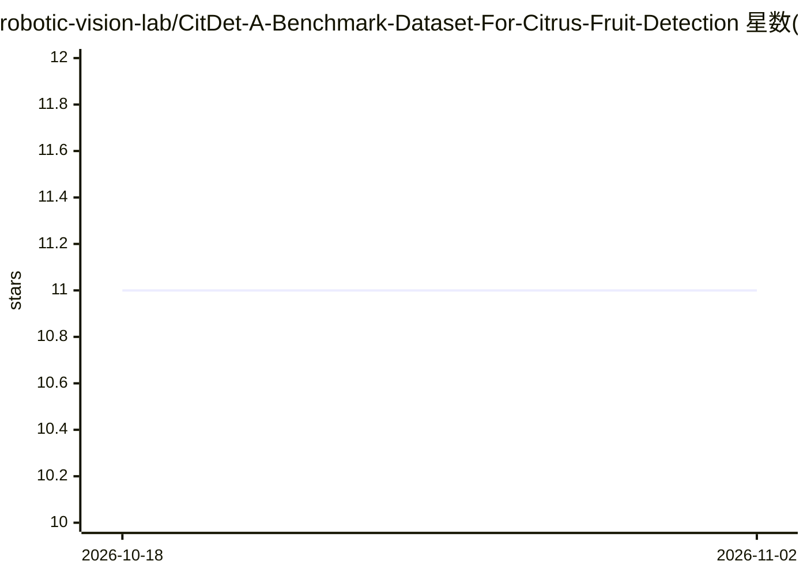

# robotic-vision-lab/CitDet-A-Benchmark-Dataset-For-Citrus-Fruit-Detection

⭐ 11 · Jupyter Notebook · Apache-2.0 · 推送 2025-12-26 · [GitHub](https://github.com/robotic-vision-lab/CitDet-A-Benchmark-Dataset-For-Citrus-Fruit-Detection) · [官网](https://robotic-vision-lab.github.io/citdet) · 组织维护

**柑橘果实检测基准数据集与评测代码**

论文配套仓库，提供 CitDet 数据集：HLB（黄龙病）高发区柑橘树的高分辨率图像及果实边界框标注，树上与落地果实均标注，可用于产量估计与落果度量。附带 COCO 数据加载器、训练/评测/可视化示例代码及 eval_coco_json.py 评测脚本，并给出 FasterRCNN、YOLOv5、YOLOv7、DETR 等检测方法在整图与切片数据集上的基准结果。安装方式为 git clone 后用 pip 安装依赖。

## 筛选速览

| 维度 | 判定 | 备注 |
|---|---|---|
| AI 角色 | `ai-knowledge` | 知识聚合/清单类 |
| 许可风险 | `permissive` | Apache-2.0 |
| 部署形态 | `library` | 以包/库形式分发 |
| 模型依赖 | — | README 未给出锁定关系 |
| 硬件要求 | — | 无带数字的原话,不猜 |
| 安装摩擦 | `low` | 无编译、无系统依赖或容器化 |
| 成熟度 | — | 结构信号不足 |

## 能力要点

- HLB 高发区柑橘高分辨率图像与高质量边界框标注
- 树上与落地果实均标注，支持落果分析
- 提供 COCO 数据加载器与评测脚本 eval_coco_json.py
- 多个检测模型在整图/切片数据集上的基准结果

## 适用场景

- 训练与评测柑橘果实检测模型
- 农业研究中估计产量与 HLB 影响
- 对比不同目标检测方法在果园场景的表现

## 场景标签

`目标检测` `模型评测` · 领域:评测与运维

## 证据(README 行号)

> L14: This repository provides source code for our paper titled "[CitDet: A Benchmark
> L16: CitDet dataset contains high-resolution images of citrus trees located in an

## 星数曲线

2026-10-18 11 → 2026-11-02 11（+0）

---
*卡片 v1 · prompt 1.4 · 生成 2026-11-01 · 置信度 high · 依据 README sha `1948c1632b35` · [字段定义](../../DATASET.md)*
