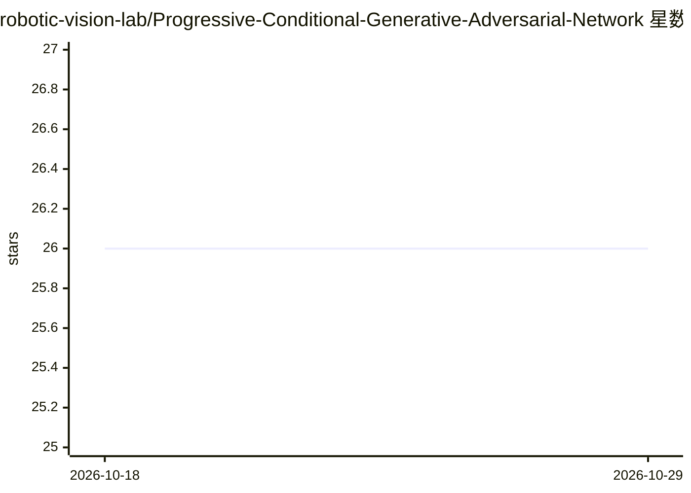

# robotic-vision-lab/Progressive-Conditional-Generative-Adversarial-Network

⭐ 26 · Python · MIT · 推送 2025-12-26 · [GitHub](https://github.com/robotic-vision-lab/Progressive-Conditional-Generative-Adversarial-Network) · 组织维护

**生成带颜色稠密3D点云的渐进式条件GAN（3DV 2020论文代码）**

2020年3DV论文《A Progressive Conditional Generative Adversarial Network for Generating Dense and Colored 3D Point Clouds》的官方源码。PCGAN以无监督方式为多类物体生成带颜色的稠密3D点云；核心机制为结合图卷积的point transformer，训练中逐次提升点云分辨率，并在固定迭代后复制末分支以增加分支数。数据源为ShapeNetCore，需经dataset_preparation.py提取点云后训练。代码在Python 3.6、PyTorch 1.3.1、CUDA 9.2、Ubuntu 19.04上测试，面向科研复现与点云生成研究。

## 筛选速览

| 维度 | 判定 | 备注 |
|---|---|---|
| AI 角色 | `ai-native` | 本体是模型或模型工具 |
| 许可风险 | `permissive` | MIT |
| 部署形态 | `None` |  |
| 模型依赖 | — | README 未给出锁定关系 |
| 硬件要求 | — | 无带数字的原话,不猜 |
| 安装摩擦 | `medium` | 含编译或系统依赖之一 |
| 成熟度 | — | 结构信号不足 |

## 能力要点

- 同时生成点云几何与颜色
- point transformer结合图卷积，逐迭代提升分辨率
- 分支复制机制逐步增长网络
- 提供ShapeNetCore数据准备脚本与训练入口train.py

## 适用场景

- 复现论文中的彩色稠密点云生成实验
- 为分类、分割、重建等视觉任务合成3D点云数据
- 研究渐进式生成网络结构在3D数据上的应用

## 场景标签

 · 领域:计算机视觉/3D生成

## 证据(README 行号)

> L18: progressive conditional generative adversarial network (PCGAN) creates dense 3D
> L19: point clouds, with color, for assorted classes of objects in an unsupervised

## 星数曲线

2026-10-18 26 → 2026-10-29 26（+0）

---
*卡片 v1 · prompt 1.4 · 生成 2026-10-26 · 置信度 high · 依据 README sha `fae025d947ed` · [字段定义](../../DATASET.md)*
