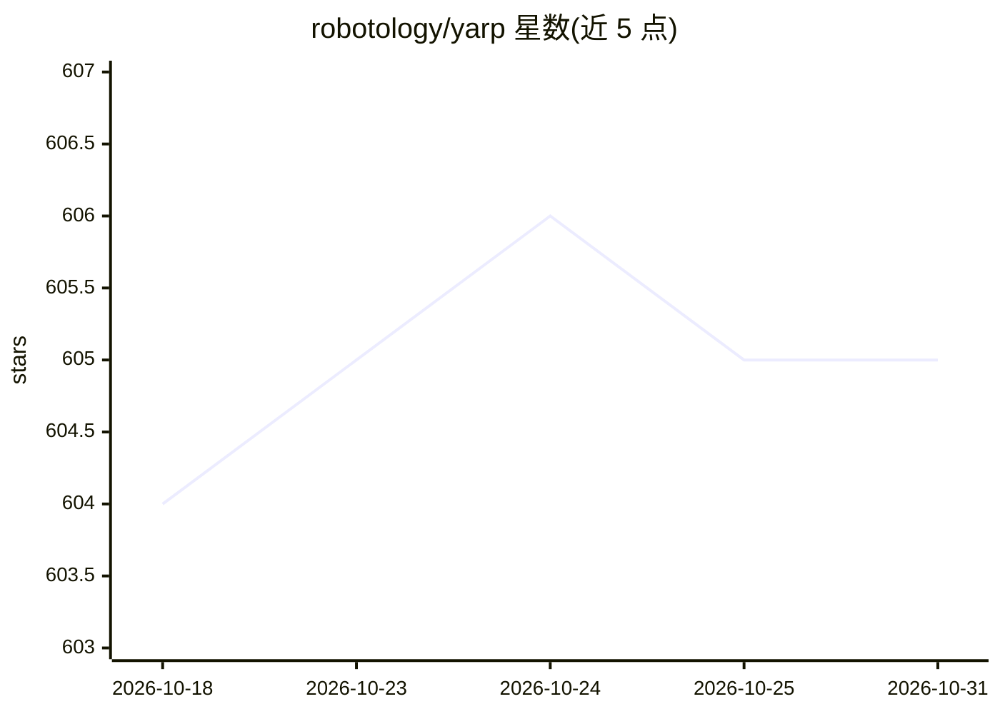

# robotology/yarp

⭐ 605 · C++ · NOASSERTION · 推送 2026-10-27 · [GitHub](https://github.com/robotology/yarp) · [官网](http://www.yarp.it) · 组织维护

**机器人进程间通信与设备接口的中间件库和工具集**

面向机器人开发者的 C++ 库与工具集，提供进程间通信和设备接口能力，应用对象从人形机器人到嵌入式设备。支持在 Linux、Windows、macOS 上经 CMake 从源码编译，常规构建依赖 ACE 库，也可通过 SKIP_ACE 选项在 Linux/macOS 上免 ACE 编译。由 Istituto Italiano di Tecnologia（IIT）与 RobotCub 联盟等维护，主体组件以 BSD-3-Clause 发布，部分可选组件采用 LGPL/GPL/Apache 许可。README 未展示 AI 相关功能。

## 筛选速览

| 维度 | 判定 | 备注 |
|---|---|---|
| AI 角色 | `ai-ecosystem` | LLM/agent 周边工具 |
| 许可风险 | `none` | NOASSERTION |
| 部署形态 | `desktop` | 安装包/桌面程序 |
| 模型依赖 | — | README 未给出锁定关系 |
| 硬件要求 | — | 无带数字的原话,不猜 |
| 安装摩擦 | `medium` | 含编译或系统依赖之一 |
| 成熟度 | — | 结构信号不足 |

## 能力要点

- 提供机器人进程间通信（IPC）与设备接口的库和工具集
- 官方 CI 测试覆盖 Ubuntu/Windows/macOS 多版本
- 支持免 ACE 编译（-DSKIP_ACE=TRUE，Linux/macOS）

## 适用场景

- 机器人各模块间的网络通信与消息传递
- 接驳机器人传感器与执行器等设备接口
- 人形机器人或嵌入式设备的软件中间件层

## 场景标签

 · 领域:机器人/中间件

## 证据(README 行号)

> L16: YARP is a library and toolkit for communication and device interfaces,
> L17: used on everything from humanoids to embedded devices.

## 星数曲线

2026-10-18 604 → 2026-10-31 605（+1）

---
*卡片 v1 · prompt 1.4 · 生成 2026-10-21 · 置信度 low · 依据 README sha `8c5c47981397` · [字段定义](../../DATASET.md)*
