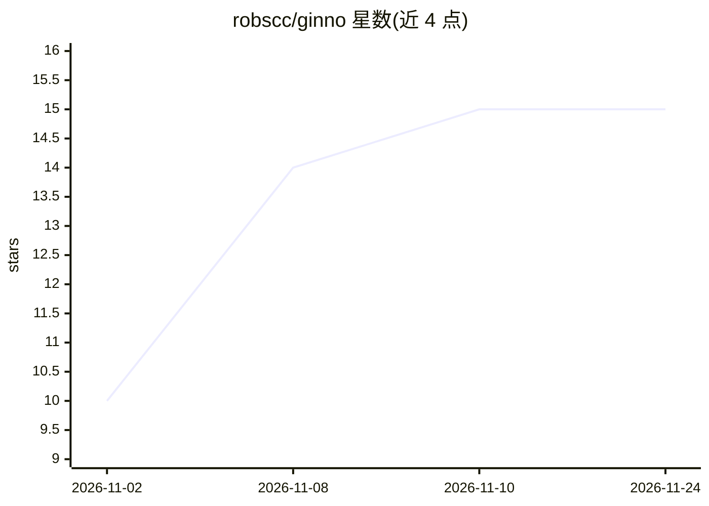

# robscc/ginno

⭐ 15 · Python · MIT · 推送 2026-11-24 · [GitHub](https://github.com/robscc/ginno) · 个人维护 · 中文 README

**本地优先的个人 AI agent 桌面应用，含可视化工作流与本地知识库**

基于 Tauri + Next.js + Python/FastAPI/LangGraph 的桌面应用，为希望在自有机器上使用 AI agent 的用户设计：多 agent 对话、工具/权限/skills/MCP/hooks、可将版本化 DSL 编译为 LangGraph 状态图的可视化 Workflow Studio、索引 Obsidian 库并带引用回答的本地知识库，以及内嵌浏览器与联网搜索。所有状态以 JSON/JSONL/Markdown 文件存于 ~/.ginno/，无数据库、无账号、无云同步；模型密钥由用户自备（OpenAI/Anthropic/DeepSeek 或兼容端点）。提供 macOS Apple Silicon 的 .dmg 下载与源码构建两种方式；作者声明项目处于早期、API 与 UI 仍在变动。

## 筛选速览

| 维度 | 判定 | 备注 |
|---|---|---|
| AI 角色 | `ai-native` | 本体是模型或模型工具 |
| 许可风险 | `permissive` | MIT |
| 部署形态 | `desktop` | 安装包/桌面程序 |
| 模型依赖 | locked-api |  |
| 硬件要求 | — | 无带数字的原话,不猜 |
| 安装摩擦 | `low` | 无编译、无系统依赖或容器化 |
| 成熟度 | `idea` | |

## 能力要点

- 可视化 Workflow Studio：版本化 DSL 编译为 LangGraph 状态图并带运行观察器
- 本地知识库可索引 Obsidian vault，回答附引用
- 全文件存储（无数据库/账号/云同步），状态位于 ~/.ginno/ 且可 git 管理
- 多 agent 对话、中期切换 agent、按 agent 记忆与长期目标 + TODO 同步

## 适用场景

- 在本机运行个人 AI agent，数据不出本地
- 用可视化工作流编排 agent 任务并观察运行
- 把 Obsidian 笔记库作为带引用的知识库来问答

## 场景标签

`AI 助手` `多智能体` `工作流自动化` `知识库管理` · 领域:Agent 开发

## 证据(README 行号)

> L19: Ginno turns the capabilities an AI agent should have into a **complete desktop app**,
> L24: - 🔀 **Visual Workflow Studio** — a versioned DSL you compile into a LangGraph state graph, with a live run observer
> L46: You bring your own model key (OpenAI / Anthropic / DeepSeek, or any compatible endpoint).

## 星数曲线

2026-11-02 10 → 2026-11-24 15（+5）

---
*卡片 v1 · prompt 1.4 · 生成 2026-11-18 · 置信度 high · 依据 README sha `574e1a6c92e5` · [字段定义](../../DATASET.md)*
