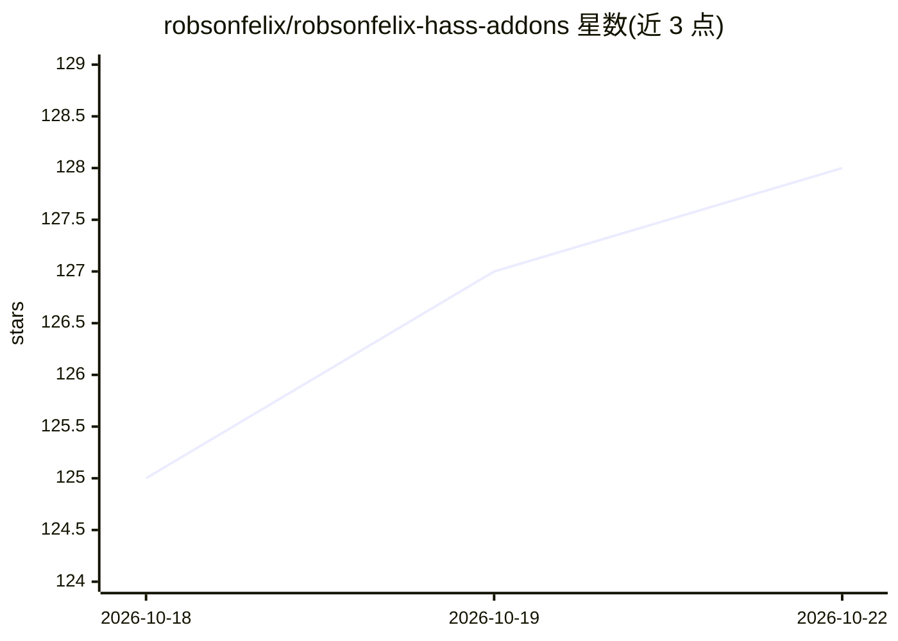

# robsonfelix/robsonfelix-hass-addons

⭐ 128 · Python · MIT · 推送 2026-07-09 · [GitHub](https://github.com/robsonfelix/robsonfelix-hass-addons) · 个人维护

**Home Assistant 自定义 add-on 仓库：含 Claude Code 等三个 add-on**

个人维护的 Home Assistant 自定义 add-on 仓库，收录三个 add-on：Claude Code（将 Anthropic 的 AI 编程助手运行在 Home Assistant 内，用于创建自动化、调试与智能家居管理）、Auto-Monocle（自动发现 HA 摄像头并经 Monocle Gateway 暴露给 Alexa）、Playwright Browser（带 CDP 端点的无头 Chromium 浏览器自动化）。通过添加仓库地址到 HA 的 Add-on Store 安装。仓库采用 MIT 许可证。

## 筛选速览

| 维度 | 判定 | 备注 |
|---|---|---|
| AI 角色 | `ai-native` | 本体是模型或模型工具 |
| 许可风险 | `permissive` | MIT |
| 部署形态 | `None` |  |
| 模型依赖 | locked-api |  |
| 硬件要求 | — | 无带数字的原话,不猜 |
| 安装摩擦 | `low` | 无编译、无系统依赖或容器化 |
| 成熟度 | — | 结构信号不足 |

## 能力要点

- Claude Code add-on 在 Home Assistant 内运行 AI 助手做自动化与调试
- Auto-Monocle 自动发现摄像头并暴露给 Alexa
- Playwright Browser 提供带 CDP 端点的无头 Chromium

## 适用场景

- 在智能家居里用 Claude Code 生成和管理 Home Assistant 自动化
- 让 Alexa 通过 Monocle Gateway 访问 HA 摄像头
- 在 HA 环境中运行浏览器自动化任务

## 场景标签

 · 领域:智能家居/自动化

## 证据(README 行号)

> L11: |Claude Code|AI assistant for automations, debugging, and smart home management|
> L12: |Auto-Monocle|Auto-discover HA cameras and expose to Alexa via Monocle Gateway|
> L13: |Playwright Browser|Headless Chromium with CDP endpoint for browser automation|

## 星数曲线

2026-10-18 125 → 2026-10-22 128（+3）

---
*卡片 v1 · prompt 1.4 · 生成 2026-10-22 · 置信度 high · 依据 README sha `dc922fa1dfd6` · [字段定义](../../DATASET.md)*
