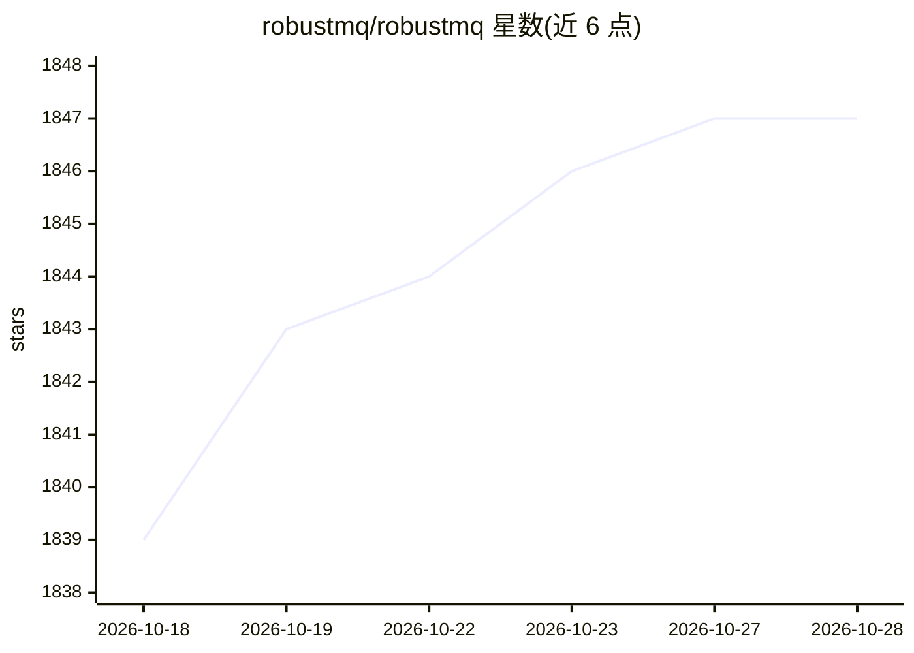

# robustmq/robustmq

⭐ 1,847 · Rust · Apache-2.0 · 推送 2026-10-28 · [GitHub](https://github.com/robustmq/robustmq) · [官网](http://robustmq.com/) · 组织维护 · 中文 README

**Rust 单二进制统一消息引擎，多协议共享存储，含 AI Agent 通信协议 mq9**

用 Rust 实现的统一消息中间件：单一二进制、无外部依赖，原生支持 MQTT、Kafka、NATS、AMQP 与 mq9 五种协议，全部共享一个存储层，一条消息可被任意协议消费。其中 mq9 面向多 Agent 系统，提供 AgentCard 注册、语义/全文发现、每 Agent 持久化邮箱（三级优先级、FETCH+ACK 消费），原生支持 A2A 协议（封装官方 a2a-sdk），并提供 Python/Go/TypeScript/Java/Rust SDK 与 LangChain 工具包。README 自述处于早期开发阶段：MQTT 核心稳定，Kafka/NATS/AMQP/mq9 开发中，生产就绪目标为 0.4.0。架构分 Meta（Raft 共识）、Broker、可插拔存储引擎三部分。

## 筛选速览

| 维度 | 判定 | 备注 |
|---|---|---|
| AI 角色 | `ai-ecosystem` | LLM/agent 周边工具 |
| 许可风险 | `permissive` | Apache-2.0 |
| 部署形态 | `library` | 以包/库形式分发 |
| 模型依赖 | — | README 未给出锁定关系 |
| 硬件要求 | — | 无带数字的原话,不猜 |
| 安装摩擦 | `low` | 无编译、无系统依赖或容器化 |
| 成熟度 | `idea` | |

## 能力要点

- 单二进制五协议（MQTT/Kafka/NATS/AMQP/mq9）共享统一存储层
- mq9：Agent 注册、语义发现、持久化邮箱与三级优先级消息
- 原生 A2A 协议支持（mq9.a2a 封装官方 a2a-sdk）
- 内存/RocksDB/File 多模式存储，冷数据自动分层至 S3

## 适用场景

- 用一套消息系统同时服务 IoT（MQTT）与流式管道（Kafka）等多种协议客户端
- 为多 Agent 系统提供 Agent 发现与可靠异步通信
- 从 RabbitMQ 等企业消息系统迁移时统一到单二进制部署
- 边缘到云同一运行时部署消息中间件

## 场景标签

 · 领域:消息中间件/分布式基础设施

## 证据(README 行号)

> L52: ## 🤖 mq9 — Communication Infrastructure for Multi-Agent Systems
> L77: - 🤖 **mq9 — Multi-Agent infrastructure**: Agent registry with full-text and semantic discovery, per-Agent persisten

## 星数曲线

2026-10-18 1,839 → 2026-10-28 1,847（+8）

---
*卡片 v1 · prompt 1.4 · 生成 2026-10-21 · 置信度 high · 依据 README sha `586bf7d8d73d` · [字段定义](../../DATASET.md)*
