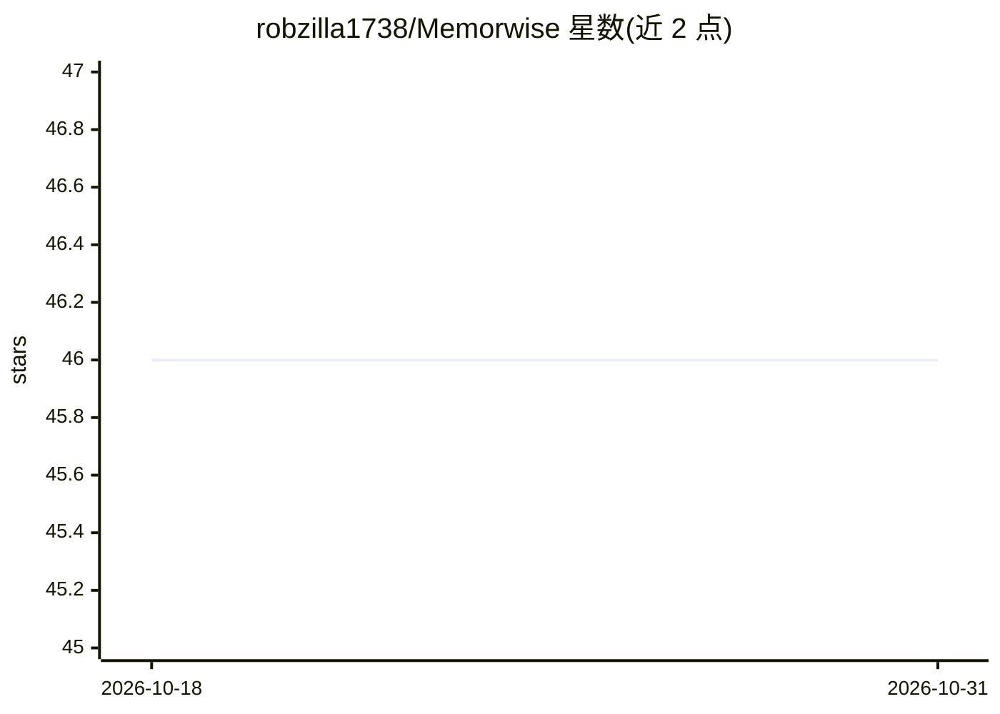

# robzilla1738/Memorwise

⭐ 46 · TypeScript · MIT · 推送 2026-06-09 · [GitHub](https://github.com/robzilla1738/Memorwise) · [官网](https://memorwise.com) · 个人维护

**本地优先的开源 NotebookLM 替代品：用任意 LLM 对话文档**

面向个人用户的本地优先文档问答应用：导入 PDF、图像、音视频、URL 或 YouTube 链接，在本机完成分块、嵌入与索引（SQLite + LanceDB），支持 8 种 LLM 提供商（Ollama、OpenAI、Anthropic、Gemini、Groq、Mistral、OpenRouter、LM Studio）并为对话、嵌入、转录、TTS 分别指定模型。功能含 RAG 引用问答、知识图谱、闪卡/测验/摘要等学习工具、播客式音频概览与 Markdown 笔记。另带 MCP 服务器（35 个工具）供 Claude Code/Cursor 访问笔记本。需 Node.js 22.13+/24+ 与 git，数据全部留在本机，无云端无账号。

## 筛选速览

| 维度 | 判定 | 备注 |
|---|---|---|
| AI 角色 | `ai-native` | 本体是模型或模型工具 |
| 许可风险 | `permissive` | MIT |
| 部署形态 | `library` | 以包/库形式分发 |
| 模型依赖 | local-ok | 支持本地模型 |
| 硬件要求 | — | 无带数字的原话,不猜 |
| 安装摩擦 | `medium` | 含编译或系统依赖之一 |
| 成熟度 | — | 结构信号不足 |

## 能力要点

- 8 种 LLM 提供商接入，可按任务混搭（对话/嵌入/转录/TTS）
- 20+ 文件格式：PDF、DOCX、图像（本地 OCR）、音视频（Whisper 转录）、URL、YouTube
- 知识图谱、闪卡/测验/学习指南、播客式音频概览等学习工具
- 内置 MCP 服务器，35 个工具供 Claude Code/Cursor 读写笔记本

## 适用场景

- 把论文、讲义、网页导入后用 RAG 问答并查看来源引用
- 从自己的资料生成闪卡、测验和音频概览辅助学习
- 在不联网、数据不出本机的前提下搭建个人知识库

## 场景标签

`文档问答` `知识库管理` `知识图谱` · 领域:知识与检索

## 证据(README 行号)

> L3: An open-source, local-first alternative to NotebookLM. Drop in PDFs, images, audio, video, URLs, or YouTube links. M
> L50: - **Chat with your documents** — RAG-powered Q&A with source citations

## 星数曲线

2026-10-18 46 → 2026-10-31 46（+0）

---
*卡片 v1 · prompt 1.4 · 生成 2026-10-25 · 置信度 high · 依据 README sha `bc38060160c0` · [字段定义](../../DATASET.md)*
