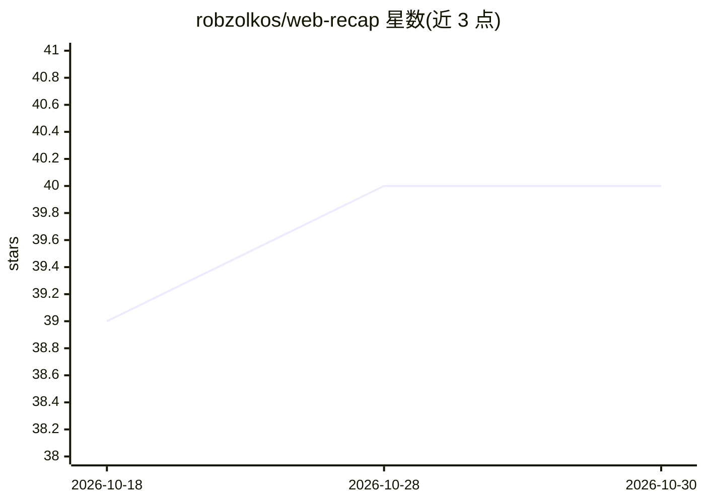

# robzolkos/web-recap

⭐ 40 · Go · MIT · 推送 2025-12-17 · [GitHub](https://github.com/robzolkos/web-recap) · 个人维护

**提取多浏览器历史并输出 LLM 可用 JSON 的 CLI 工具**

用 Go 编写的跨平台命令行工具，从 Chrome、Chromium、Edge、Brave、Firefox、Safari 的 SQLite 历史数据库读取浏览记录，输出面向 LLM 消费的 JSON（含 URL、标题、域名、访问次数等字段）。支持按日期/时间段/时区过滤，自动检测已装浏览器并处理数据库锁定，可自动复制临时文件在浏览器运行时读取。数据全程本地处理，用户可自行把输出管道给 Claude 等 LLM 或保存为文件。提供预编译二进制与源码编译两种安装方式。

## 筛选速览

| 维度 | 判定 | 备注 |
|---|---|---|
| AI 角色 | `ai-ecosystem` | LLM/agent 周边工具 |
| 许可风险 | `permissive` | MIT |
| 部署形态 | `desktop` | 安装包/桌面程序 |
| 模型依赖 | — | README 未给出锁定关系 |
| 硬件要求 | — | 无带数字的原话,不猜 |
| 安装摩擦 | `low` | 无编译、无系统依赖或容器化 |
| 成熟度 | — | 结构信号不足 |

## 能力要点

- 支持 6 种浏览器、三大平台，自动检测或手动指定
- 输出面向 LLM 消费的 JSON 格式
- 纯 Go 实现无 CGO，自动处理数据库锁定
- 日期/时间/时区多维过滤（--date、--tz、--utc、--time）

## 适用场景

- 把我的浏览记录整理成 JSON 交给 LLM 做活动总结
- 按日期或时段导出特定浏览历史用于分析
- 脚本/CI 中以 UTC 口径提取历史数据

## 场景标签

 · 领域:开发者工具/数据处理

## 证据(README 行号)

> L3: Extract browser history from Chrome, Chromium, Brave, Firefox, Safari, and Edge browsers and output it in JSON forma
> L108: The JSON output is designed to be easily consumed by language models. You can pipe the output directly to your LLM

## 星数曲线

2026-10-18 39 → 2026-10-30 40（+1）

---
*卡片 v1 · prompt 1.4 · 生成 2026-10-25 · 置信度 high · 依据 README sha `7745af3a3e2a` · [字段定义](../../DATASET.md)*
