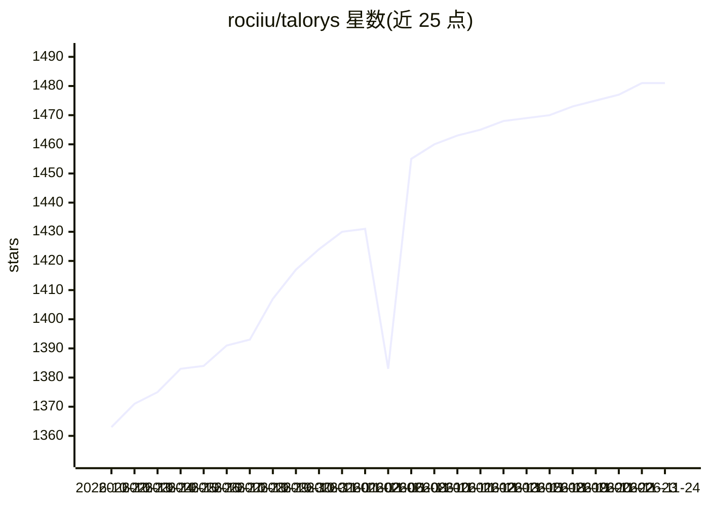

# rociiu/talorys

⭐ 1,481 · TypeScript · MIT · 推送 2026-11-17 · [GitHub](https://github.com/rociiu/talorys) · [官网](https://rociiu.github.io/talorys/) · 个人维护

**部署在用户自己 Cloudflare 账户的单人 AI 助手**

在用户自己的 Cloudflare 账户内运行的个人 AI 助手，一条 npx 命令完成部署。功能包括流式聊天、可查看编辑的记忆管理、任务/笔记/项目、基于 Durable Object 定时器的提醒与自动化、可选语义召回、远程 MCP 服务器接入和 Tavily/Exa 网页搜索。聊天模型使用 Cloudflare Workers AI 的 GLM 模型，数据存于账户内的 SQLite Durable Object，无遥测代码。免费套餐额度用尽时 AI 功能暂停，其余功能仍可用。

## 筛选速览

| 维度 | 判定 | 备注 |
|---|---|---|
| AI 角色 | `ai-native` | 本体是模型或模型工具 |
| 许可风险 | `permissive` | MIT |
| 部署形态 | `library` | 以包/库形式分发 |
| 模型依赖 | — | README 未给出锁定关系 |
| 硬件要求 | — | 无带数字的原话,不猜 |
| 安装摩擦 | `low` | 无编译、无系统依赖或容器化 |
| 成熟度 | — | 结构信号不足 |

## 能力要点

- 一条 npx 命令部署到用户自己的 Cloudflare 账户，无开发者运营的服务器
- 记忆可查看、编辑、删除，且随时间变化时可确认为历史事实
-  Workers AI 免费额度用尽后聊天暂停但其余功能继续工作
- 设置面板内一键导出/导入 JSON 备份

## 适用场景

- 在不依赖第三方托管服务的前提下运行私人 AI 助手
- 通过对话创建任务、计划目标并接收定时提醒
- 接入远程 MCP 服务器扩展助手的可用工具

## 场景标签

`AI 助手` · 领域:对话与助手

## 证据(README 行号)

> L7: Talorys is a free, open-source personal AI assistant that runs entirely inside
> L78: |Workers AI|Chat model (`@cf/zai-org/glm-4.7-flash`)|Yes, daily allocation|

## 星数曲线

2026-10-22 1,363 → 2026-11-24 1,481（+118）

---
*卡片 v1 · prompt 1.4 · 生成 2026-11-23 · 置信度 high · 依据 README sha `48dcae741d2c` · [字段定义](../../DATASET.md)*
