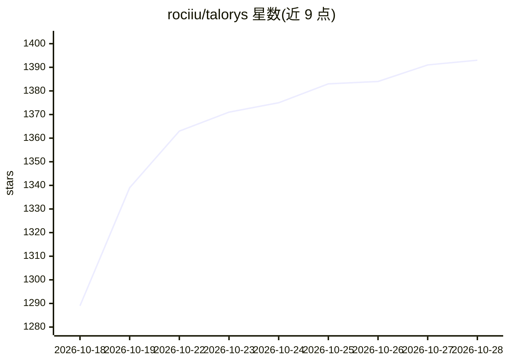

# rociiu/talorys

⭐ 1,393 · TypeScript · MIT · 推送 2026-10-27 · [GitHub](https://github.com/rociiu/talorys) · [官网](https://rociiu.github.io/talorys/) · 个人维护

**部署在自己 Cloudflare 账号的单用户个人 AI 助手**

开源单用户个人 AI 助手，通过 npx create-talorys@latest 一条命令部署到用户自己的 Cloudflare 账号：前端 Pages + 私有 Worker（无公开 URL），所有数据存于 SQLite Durable Object，聊天模型用 Workers AI（@cf/zai-org/glm-4.7-flash）。功能含流式对话、持久记忆（可选语义召回与事实历史）、任务/笔记/项目管理、基于 Durable Object alarms 的定时提醒与推送通知。单用户设计、无遥测，设计上兼容 Cloudflare 免费额度；AI 配额耗尽时任务/笔记/提醒仍可工作。

## 筛选速览

| 维度 | 判定 | 备注 |
|---|---|---|
| AI 角色 | `ai-native` | 本体是模型或模型工具 |
| 许可风险 | `permissive` | MIT |
| 部署形态 | `library` | 以包/库形式分发 |
| 模型依赖 | — | README 未给出锁定关系 |
| 硬件要求 | — | 无带数字的原话,不猜 |
| 安装摩擦 | `low` | 无编译、无系统依赖或容器化 |
| 成熟度 | — | 结构信号不足 |

## 能力要点

- 一条 npx 命令部署到自己 Cloudflare 账号，私有 Worker 无公开 URL
- 持久记忆：可选语义召回、事实历史（现役/过去事实）与冲突审查
- 基于 Durable Object alarms 的定时提醒/每日摘要与端到端加密 Web Push
- Workers AI 不可用时任务、笔记、记忆、提醒继续工作

## 适用场景

- 在自己的 Cloudflare 免费额度内自托管一个私人 AI 助手
- 让助手通过对话管理任务、笔记、项目与定时提醒
- 跨设备登录使用同一助手并接收系统推送通知

## 场景标签

`AI 助手` · 领域:对话与助手

## 证据(README 行号)

> L7: Talorys is a free, open-source personal AI assistant that runs entirely inside
> L8: **your own Cloudflare account**. It chats with you, remembers what matters,
> L71: |Workers AI|Chat model (`@cf/zai-org/glm-4.7-flash`)|Yes, daily allocation|

## 星数曲线

2026-10-18 1,289 → 2026-10-28 1,393（+104）

---
*卡片 v1 · prompt 1.4 · 生成 2026-10-21 · 置信度 high · 依据 README sha `4281a1628759` · [字段定义](../../DATASET.md)*
