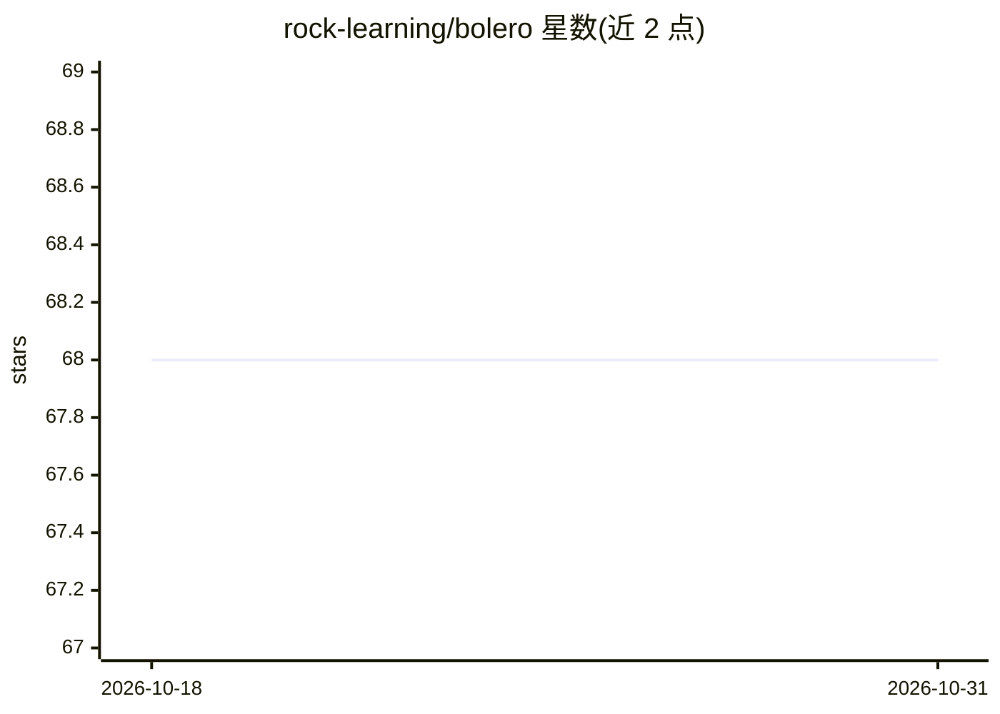

# rock-learning/bolero

⭐ 68 · C++ · NOASSERTION · 推送 2026-04-29 · [GitHub](https://github.com/rock-learning/bolero) · [官网](https://rock-learning.github.io/bolero) · 组织维护

**机器人行为学习与优化库：强化学习/黑盒优化/模仿学习**

BOLeRo（Behavior Learning and Optimization for Robots）提供学习机器人行为的工具集，涵盖行为表示、强化学习、黑盒优化、进化算法与模仿学习。同时提供 C++ 与 Python 接口，以便在需要效率处用 C++、在便利性优先处用 Python；C++ 接口便于集成到 ROS、Rock 等机器人框架。Ubuntu 18.04 可通过 bootstrap 脚本安装，Python 3 需先安装 cython3。含 benchmarks、examples 等目录，作者团队发表论文于 International Journal of Advanced Robotic Systems。

## 筛选速览

| 维度 | 判定 | 备注 |
|---|---|---|
| AI 角色 | `ai-native` | 本体是模型或模型工具 |
| 许可风险 | `none` | NOASSERTION |
| 部署形态 | `None` |  |
| 模型依赖 | — | README 未给出锁定关系 |
| 硬件要求 | — | 无带数字的原话,不猜 |
| 安装摩擦 | `low` | 无编译、无系统依赖或容器化 |
| 成熟度 | — | 结构信号不足 |

## 能力要点

- 行为表示与强化学习、黑盒优化、进化算法、模仿学习
- C++ 与 Python 双接口
- C++ 接口便于集成 ROS / Rock 等机器人框架
- benchmarks 目录含复现科学论文结果的脚本

## 适用场景

- 为机器人学习控制器行为并集成到 ROS/Rock 工程
- 运行论文结果复现的 benchmark 脚本
- 用 Python 快速实验、用 C++ 部署高性能部分

## 场景标签

`强化学习` · 领域:训练与推理

## 证据(README 行号)

> L6: BOLeRo (Behavior Learning and Optimization for Robots) provides tools to learn
> L8: reinforcement learning, black-box optimization, evolutionary algorithms, and
> L9: imitation learning. It provides a C++ and a Python interface to be efficient

## 星数曲线

2026-10-18 68 → 2026-10-31 68（+0）

---
*卡片 v1 · prompt 1.4 · 生成 2026-10-24 · 置信度 high · 依据 README sha `9cb959097144` · [字段定义](../../DATASET.md)*
