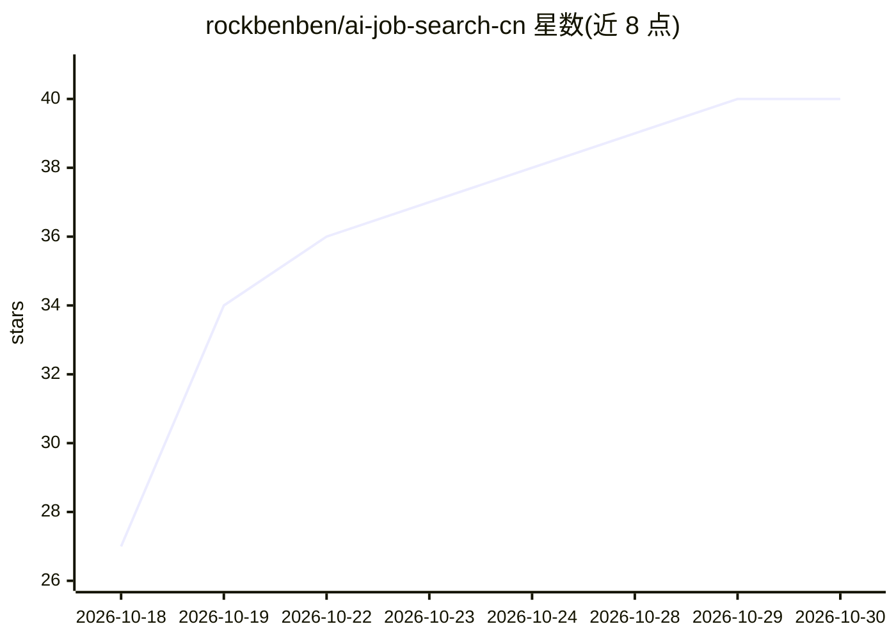

# rockbenben/ai-job-search-cn

⭐ 40 · Python · MIT · 推送 2026-10-26 · [GitHub](https://github.com/rockbenben/ai-job-search-cn) · 个人维护 · 中文 README

**本机运行的国内 AI 求职助手：搜岗、按国内门槛评分、出话术与简历**

面向国内求职者的 agent 技能/工作流仓库，通过 Claude Code、Codex CLI、Qwen Code 等 AI 编码工具驱动：搜索猎聘、BOSS 直聘、智联、前程无忧的职位，按国内硬性条件（学历、户口、外包/编制、执业资格）预筛，再按技能·薪资·强度·发展打分，产出打招呼话术、邮件、求职信与 Typst 简历；不代用户投递。个人数据全部落在 users/ 目录且被 gitignore，不发往 JD 中出现的地址。可单独使用零依赖的 liepin-search CLI（Node 22.18+）。README 标注有四条命令未经完整实测（L220-221）。

## 筛选速览

| 维度 | 判定 | 备注 |
|---|---|---|
| AI 角色 | `ai-native` | 本体是模型或模型工具 |
| 许可风险 | `permissive` | MIT |
| 部署形态 | `library` | 以包/库形式分发 |
| 模型依赖 | — | README 未给出锁定关系 |
| 硬件要求 | — | 无带数字的原话,不猜 |
| 安装摩擦 | `medium` | 含编译或系统依赖之一 |
| 成熟度 | `idea` | |

## 能力要点

- 覆盖 4 家国内招聘站，按学历/户口/外包等国内硬性条件预筛后打分
- 抓→评→出材料的 /job-auto 一条命令循环，产出话术/求职信/简历但不代投递
- 个人数据全在本机 users/ 目录，框架不向 JD 中的地址发送数据
- 不绑定单一 AI 工具：Claude Code/Codex/Qwen Code 等经 AGENTS.md 接入

## 适用场景

- 我想让 AI 帮我把不符合硬性条件的岗位先筛掉，只投对口的
- 我想要现成的打招呼开场白和针对性中文简历
- 我想在本地总览页跟踪投递状态和回复率

## 场景标签

`网页抓取` `AI 写作` · 领域:效率与自动化

## 证据(README 行号)

> L3: > 本机运行的 AI 求职助手：搜岗、按国内维度评分、出投递话术与中文简历，数据不上传
> L44: - **`/job-auto`** — 把上面三段接成循环：抓 → 评 → 给能投的出材料，**一直跑到挖不动为止**。要限量加 `--target N`

## 星数曲线

2026-10-18 27 → 2026-10-30 40（+13）

---
*卡片 v1 · prompt 1.4 · 生成 2026-10-25 · 置信度 mid · 依据 README sha `28de0f4472c6` · [字段定义](../../DATASET.md)*
