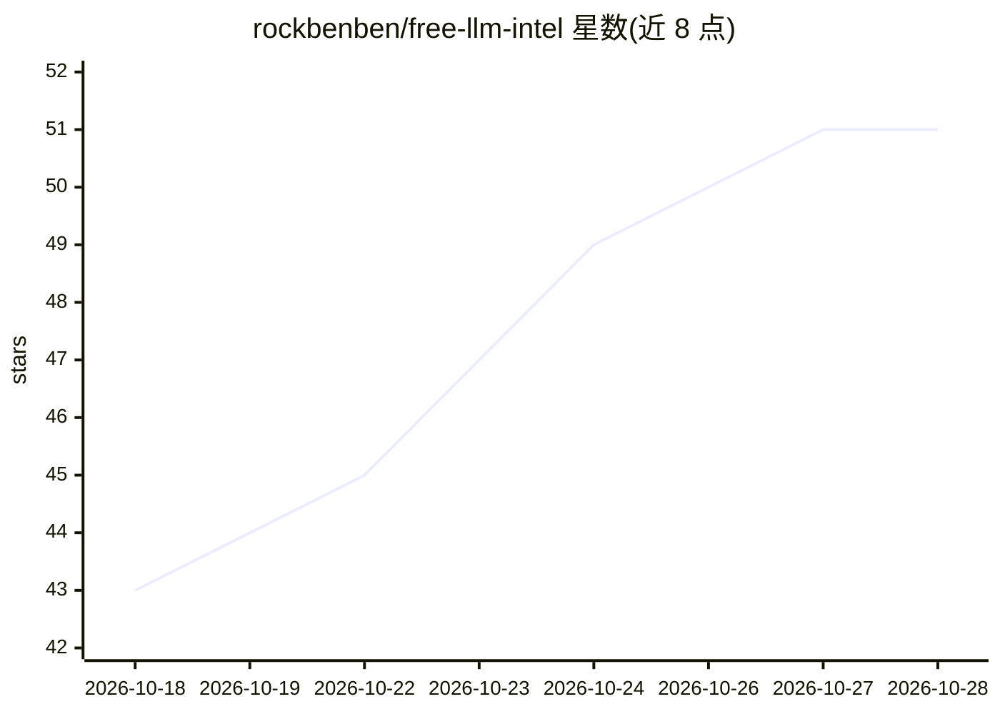

# rockbenben/free-llm-intel

⭐ 51 · Python · MIT · 推送 2026-10-28 · [GitHub](https://github.com/rockbenben/free-llm-intel) · [官网](https://free-llm-intel.aishort.top/) · 个人维护 · 中文 README

**LLM 免费额度与厂商动态情报站：脚本每日巡检官方页生成总表与 RSS**

聚合国内外 70 家 LLM 平台免费 API 额度、永久免费模型与限时活动信息的仓库。由巡检脚本对照官方页面自动更新，每条情报附官方链接可复核，无法核实的旧说法标注「不予采信」；不提供、不分发任何 API Key。内容含免费额度四类分档总表、白嫖攻略、防扣费清单、OpenAI 兼容端点速查表，以及厂商官方博客的 RSS 订阅源（含英文原文中文翻译）。用户可通过 pip 安装依赖自行运行巡检脚本。

## 筛选速览

| 维度 | 判定 | 备注 |
|---|---|---|
| AI 角色 | `ai-knowledge` | 知识聚合/清单类 |
| 许可风险 | `permissive` | MIT |
| 部署形态 | `library` | 以包/库形式分发 |
| 模型依赖 | — | README 未给出锁定关系 |
| 硬件要求 | — | 无带数字的原话,不猜 |
| 安装摩擦 | `low` | 无编译、无系统依赖或容器化 |
| 成熟度 | — | 结构信号不足 |

## 能力要点

- 70 家厂商免费额度/活动总表，脚本每日对照官方页自动更新
- 每条情报附官方链接，不可复核的说法标注「不予采信」
- 提供厂商动态 RSS 订阅源（OPML 一键导入，英文原文中文翻译）
- OpenAI 兼容端点速查表，适配 NextChat/Cherry Studio/Dify 等客户端

## 适用场景

- 挑选可免费试用的 LLM API 平台，避免误绑信用卡
- 订阅各家 LLM 厂商动态的中文 RSS 更新
- 用免费模型接入 Chatbox、Dify 等支持 OpenAI 兼容格式的客户端
- 追踪各家免费政策变化以防意外扣费

## 场景标签

`精选清单` · 领域:学习与行业

## 证据(README 行号)

> L3: > 国内外 LLM 厂商的免费 API 额度、永久免费模型与限时活动情报，**每天由脚本对照官方页面自动更新、每条可复核**：
> L12: - 📡 订阅厂商动态：导入 llm-news-feeds.opml 一次订全（官方原生源 + 自建源 + 聚合流 + 英文镜像）；网页一键订阅 ｜ 合并流 ｜ 英文合并流 ｜ 单厂商源 `…/feeds/llm-news-<厂商 

## 星数曲线

2026-10-18 43 → 2026-10-28 51（+8）

---
*卡片 v1 · prompt 1.4 · 生成 2026-10-24 · 置信度 mid · 依据 README sha `acd871f7c382` · [字段定义](../../DATASET.md)*
