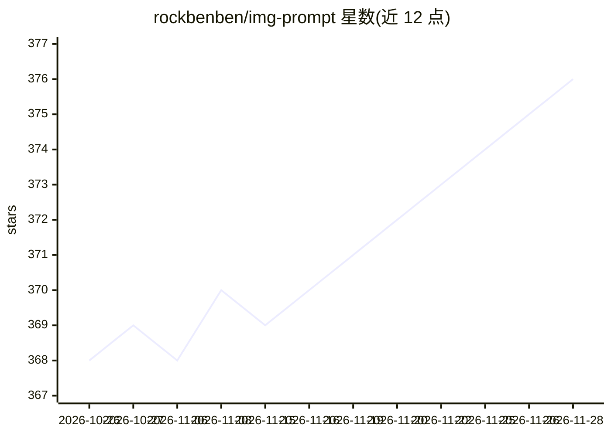

# rockbenben/img-prompt

⭐ 376 · TypeScript · MIT · 推送 2026-11-26 · [GitHub](https://github.com/rockbenben/img-prompt) · [官网](https://prompt.newzone.top) · 个人维护 · 中文 README

**给非英语用户的 AI 绘图/视频提示词标签编辑器**

IMGPrompt 是面向 AI 图像与视频生成的提示词编辑器，针对不习惯用英文思考的用户：将 5,000+ 术语按主题与分类组织，以母语标注并几乎都带预览图，点击标签即在右侧面板拼出 GPT-Image-2、Midjourney、FLUX、Veo 等模型所需的英文提示词。支持 18 种界面语言、内置多翻译源、导入私有 JSON 标签库（≤2MB）、移动端编辑条。无后端，草稿存于浏览器；可在浏览器直接使用，也可安装桌面应用或 Docker 自托管。

## 筛选速览

| 维度 | 判定 | 备注 |
|---|---|---|
| AI 角色 | `ai-ecosystem` | LLM/agent 周边工具 |
| 许可风险 | `permissive` | MIT |
| 部署形态 | `self-host` | docker 或自建部署 |
| 模型依赖 | — | README 未给出锁定关系 |
| 硬件要求 | — | 无带数字的原话,不猜 |
| 安装摩擦 | `low` | 无编译、无系统依赖或容器化 |
| 成熟度 | — | 结构信号不足 |

## 能力要点

- 5,000+ 双语标签按主题与分类组织，几乎全部带预览图
- 点击标签自动拼装目标模型所需英文提示词
- 18 种语言界面与标签库，支持导入私有 JSON 标签库
- 无后端设计，支持浏览器、桌面应用与 Docker 自托管三种运行方式

## 适用场景

- 不熟悉英文术语时为 Midjourney/GPT-Image 等拼装提示词
- 搜索并浏览带预览图的光效、镜头等标签库
- 在内网或 NAS 上自托管私有提示词编辑器
- 导入自己的 JSON 标签库管理私有词表

## 场景标签

`提示工程` `图像生成` `视频生成` · 领域:Agent 开发

## 证据(README 行号)

> L15: You know the look you are after — you just don't know that models call it `Tyndall effect`, `film grain` or `Fishey
> L23: |**Run it in**|Any modern browser, nothing to install · Windows (exe / msi) · macOS (Intel + Apple Silicon) · Linux

## 星数曲线

2026-10-26 368 → 2026-11-28 376（+8）

---
*卡片 v1 · prompt 1.4 · 生成 2026-11-27 · 置信度 high · 依据 README sha `b59d20d19ed8` · [字段定义](../../DATASET.md)*
