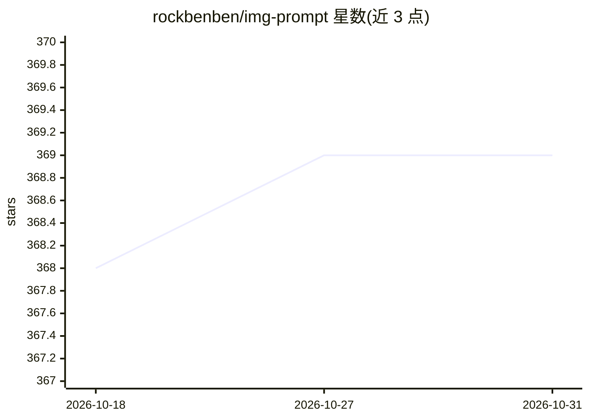

# rockbenben/img-prompt

⭐ 369 · TypeScript · MIT · 推送 2026-10-07 · [GitHub](https://github.com/rockbenben/img-prompt) · [官网](https://prompt.newzone.top) · 个人维护 · 中文 README

**非英文用户点选母语标签自动拼装英文 AI 绘图/视频提示词**

面向不以英文思考的 AI 图像与视频模型用户的提示词编辑器：将 5,040 个双语标签按 16 主题、212 分类组织，几乎所有标签带预览图；点击标签即在右侧面板组装成 GPT-Image-2、Midjourney、FLUX、Veo 等模型使用的英文提示词。支持 18 种界面语言、自由文本翻译框与提示词清理功能。无后端，选择状态保存在 URL 与浏览器中；可在浏览器直接使用，也提供 Windows/macOS/Linux 桌面版与 Docker 自托管镜像。限制：翻译框会将文本发往免费公共翻译端点（Google/Edge/有道/MyMemory），标签预览图依赖 CDN 网络连接。

## 筛选速览

| 维度 | 判定 | 备注 |
|---|---|---|
| AI 角色 | `ai-ecosystem` | LLM/agent 周边工具 |
| 许可风险 | `permissive` | MIT |
| 部署形态 | `self-host` | docker 或自建部署 |
| 模型依赖 | — | README 未给出锁定关系 |
| 硬件要求 | — | 无带数字的原话,不猜 |
| 安装摩擦 | `low` | 无编译、无系统依赖或容器化 |
| 成熟度 | — | 结构信号不足 |

## 能力要点

- 5,040 个双语标签，16 主题 212 分类，绝大多数带预览图
- 支持 GPT-Image-2、Midjourney、FLUX、Veo、Kling 等模型提示词组装
- 18 种界面语言，标签库同步翻译，阿拉伯语右到左渲染
- 标签库为开放 JSON 数据文件，可 fork 扩展

## 适用场景

- 不熟悉英文术语的用户点选标签生成专业提示词
- 查找'泰德尔效应''鱼眼镜头'等专业术语的英文模型说法
- 在内网/家庭服务器上自托管供团队使用

## 场景标签

`提示工程` · 领域:Agent 开发

## 证据(README 行号)

> L13: IMGPrompt: pick a subject, pick a category, click tags — the English prompt builds in the right-hand panel
> L15: You know the look you are after — you just don't know that models call it `Tyndall effect`, `film grain` or `Fishey
> L21: |**Target models**|GPT-Image-2 · Nano Banana · Midjourney · FLUX · Seedance · Veo · Kling — also compatible with St

## 星数曲线

2026-10-18 368 → 2026-10-31 369（+1）

---
*卡片 v1 · prompt 1.4 · 生成 2026-10-21 · 置信度 high · 依据 README sha `b4de7ac7ffbf` · [字段定义](../../DATASET.md)*
