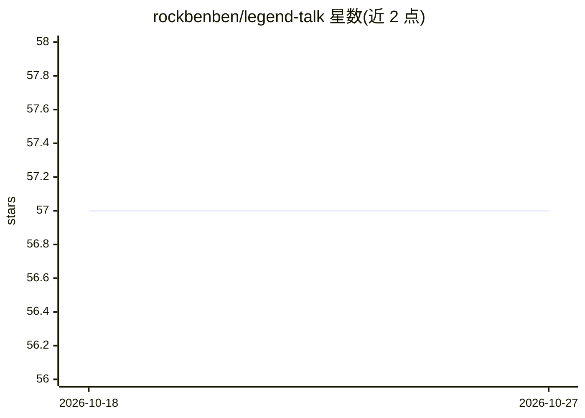

# rockbenben/legend-talk

⭐ 57 · TypeScript · MIT · 推送 2026-10-22 · [GitHub](https://github.com/rockbenben/legend-talk) · [官网](https://talk.newzone.top/) · 个人维护 · 中文 README

**与161位思想家多轮圆桌辩论的AI对话应用**

面向终端用户的Web应用：将2–10位历史或当代思想家（内置161位预设，可自定义）组织成多轮辩论，每轮各角色以自身思想框架发言，AI主持人归纳分歧并引出下一轮；用户作为chair可中途引导、编辑重生成、分支对话。支持25家API提供商及任意OpenAI兼容本地端点（Ollama、LM Studio等），本地优先存储、18种语言、零CDN。自行部署需npm安装并填入API key；部分提供商默认经公共CORS代理转发（密钥会经过该代理）。

## 筛选速览

| 维度 | 判定 | 备注 |
|---|---|---|
| AI 角色 | `ai-native` | 本体是模型或模型工具 |
| 许可风险 | `permissive` | MIT |
| 部署形态 | `library` | 以包/库形式分发 |
| 模型依赖 | local-ok | 支持本地模型 |
| 硬件要求 | — | 无带数字的原话,不猜 |
| 安装摩擦 | `low` | 无编译、无系统依赖或容器化 |
| 成熟度 | — | 结构信号不足 |

## 能力要点

- 2–10位思想家多轮辩论+AI主持人归纳分歧与开放问题
- 内置161位思想家预设，15个领域，支持自定义角色
- 25家API提供商开箱即用，任意OpenAI兼容地址可接入本地模型
- 本地优先（IndexedDB双写）、零CDN、18种语言、对话可分享/导出

## 适用场景

- 让观点冲突的思想家就一个话题展开多轮辩论
- 与任意一位思想家进行1对1对话
- 通过分享链接或Markdown/JSON导出保存和传播圆桌讨论

## 场景标签

`聊天机器人` · 领域:对话与助手

## 证据(README 行号)

> L35: Legend Talk convenes 2–10 historical or contemporary thinkers into a multi-round debate. Each round, every voice ar
> L65: - **Moderator** — after each round, an AI moderator synthesizes it: groups claims by idea, names an angle the round

## 星数曲线

2026-10-18 57 → 2026-10-27 57（+0）

---
*卡片 v1 · prompt 1.4 · 生成 2026-10-24 · 置信度 high · 依据 README sha `9c3d0cdb0ad2` · [字段定义](../../DATASET.md)*
