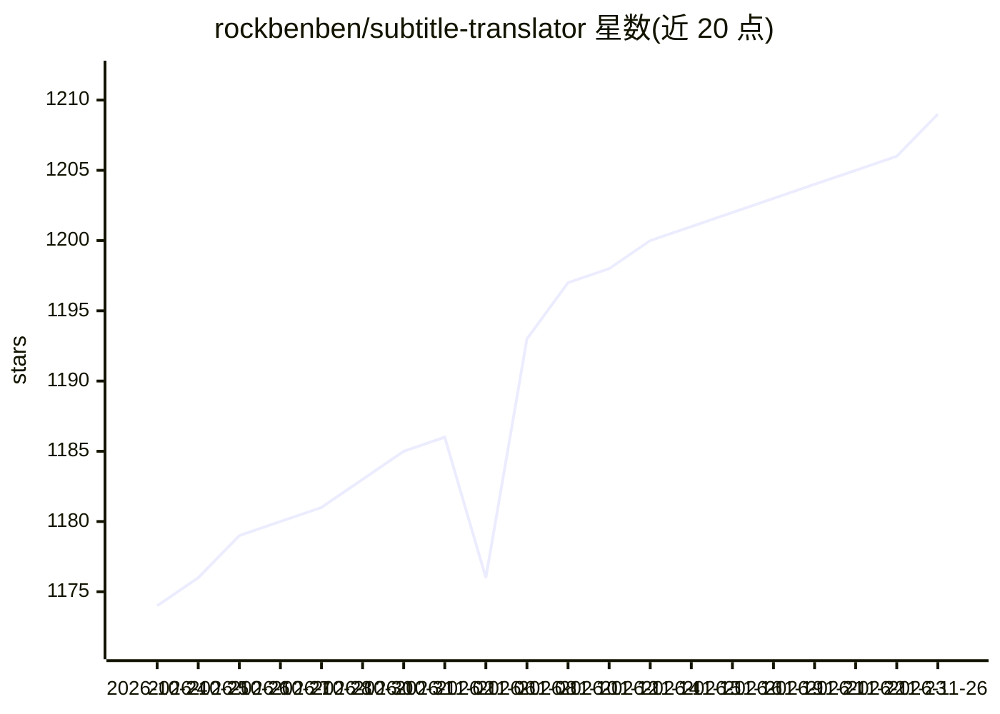

# rockbenben/subtitle-translator

⭐ 1,209 · TypeScript · MIT · 推送 2026-11-17 · [GitHub](https://github.com/rockbenben/subtitle-translator) · [官网](https://tools.newzone.top/en/subtitle-translator) · 个人维护 · 中文 README

**浏览器端批量字幕翻译工具：整季一次译完且不动时轴**

面向需要批量翻译字幕的用户，读取 .srt/.ass/.vtt/.lrc 文件，在本地剥离时间轴与 cue 编号后仅将台词文本发送至翻译引擎，翻译后重组还原时轴。支持 8 个传统机器翻译 API 与 27 个 LLM 提供商/网关、120+ 目标语言、一次输出多语言文件、双语字幕导出。默认运行在浏览器中（数据与 API key 不出本地），另提供 yarn cli 以命令行无头运行同一引擎，支持断点续译与本地缓存。

## 筛选速览

| 维度 | 判定 | 备注 |
|---|---|---|
| AI 角色 | `ai-native` | 本体是模型或模型工具 |
| 许可风险 | `permissive` | MIT |
| 部署形态 | `None` |  |
| 模型依赖 | local-ok | 支持本地模型 |
| 硬件要求 | — | 无带数字的原话,不猜 |
| 安装摩擦 | `low` | 无编译、无系统依赖或容器化 |
| 成熟度 | — | 结构信号不足 |

## 能力要点

- 本地剥离时轴后仅发送台词，翻译结果重组时间轴
- 批量上传整季字幕，逐文件独立翻译并导出汇总结果
- 支持 8 个传统 MT API 与 27 个 LLM 提供商/网关，120+ 语言
- LLM 模式支持上下文台词、自定义 prompt、温度与思考模式

## 适用场景

- 一次翻译整季动漫/剧集的字幕文件
- 制作原文+译文的双语字幕
- 将 LRC 歌词或 Markdown、JSON 文案批量翻译成多语言

## 场景标签

 · 领域:翻译/字幕工具

## 证据(README 行号)

> L12: **Subtitle Translator** is a free, browser-based batch subtitle translation tool for `.srt`, `.ass`, `.vtt`, and `.
> L55: **DeepSeek**, **OpenAI**, **Claude**, **Gemini**, **Qwen**, **Moonshot (Kimi)**, **Doubao**, **Xiaomi MiMo**, **Zhi
> L59: **OpenRouter**, **OpenCode Zen**, **Groq**, **SiliconFlow**, **Atlas Cloud**, **GitHub Models**, **Nvidia NIM**, **

## 星数曲线

2026-10-24 1,174 → 2026-11-26 1,209（+35）

---
*卡片 v1 · prompt 1.4 · 生成 2026-11-23 · 置信度 high · 依据 README sha `a635066a59af` · [字段定义](../../DATASET.md)*
