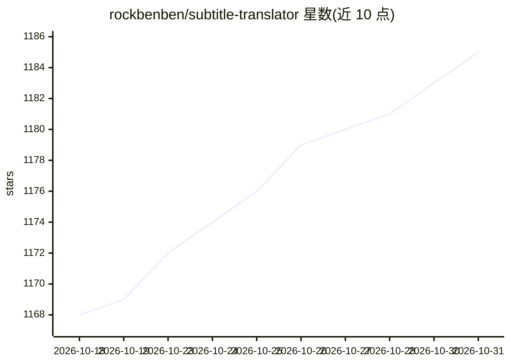

# rockbenben/subtitle-translator

⭐ 1,185 · TypeScript · MIT · 推送 2026-10-29 · [GitHub](https://github.com/rockbenben/subtitle-translator) · [官网](https://tools.newzone.top/en/subtitle-translator) · 个人维护 · 中文 README

**浏览器端整季字幕批量翻译工具，时轴本地保护**

免费、纯客户端的批量字幕翻译工具，支持 .srt/.ass/.vtt/.lrc 自动识别与格式互转。核心机制：时轴、序号、ASS 头在本地剥离，仅将台词文本发送至翻译引擎，翻译后回插，时间轴不可被模型改动。可接入 8 个传统机器翻译 API 与 27 个 LLM 提供商/网关，翻译为 120+ 语言或一次输出多目标语言，支持双语字幕、上下文感知翻译（LLM）与 IndexedDB 无限缓存。提供在线 Demo、yarn cli 无头命令行（同引擎、可断点续跑）及源码自部署，运行需 Node.js >= 24。

## 筛选速览

| 维度 | 判定 | 备注 |
|---|---|---|
| AI 角色 | `ai-native` | 本体是模型或模型工具 |
| 许可风险 | `permissive` | MIT |
| 部署形态 | `None` |  |
| 模型依赖 | local-ok | 支持本地模型 |
| 硬件要求 | — | 无带数字的原话,不猜 |
| 安装摩擦 | `low` | 无编译、无系统依赖或容器化 |
| 成熟度 | — | 结构信号不足 |

## 能力要点

- 本地剥离时轴仅发送台词，时间轴不受模型影响
- 整季批量上传，多目标语言单次输出各自成文件
- 8 传统 MT API + 27 LLM 提供商/网关，120+ 语言
- 纯浏览器端运行，字幕与 API key 不经过服务器；CLI 可断点续跑

## 适用场景

- 把一整季视频字幕批量翻译成目标语言
- 生成原文在上、译文在下的双语字幕文件
- 用 LLM 带上下文翻译对白并保持人名术语一致
- 脚本化批量翻译字幕/Markdown/JSON 语言文件

## 场景标签

 · 领域:翻译/字幕工具

## 证据(README 行号)

> L12: **Subtitle Translator** is a free, browser-based batch subtitle translation tool for `.srt`, `.ass`, `.vtt`, and `.
> L26: - **Structural Separation**: Timecodes, cue numbers, ASS headers, and VTT cue IDs are extracted locally — only dial

## 星数曲线

2026-10-18 1,168 → 2026-10-31 1,185（+17）

---
*卡片 v1 · prompt 1.4 · 生成 2026-10-22 · 置信度 high · 依据 README sha `1112b0ff12e3` · [字段定义](../../DATASET.md)*
